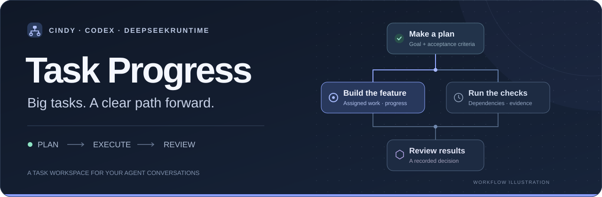
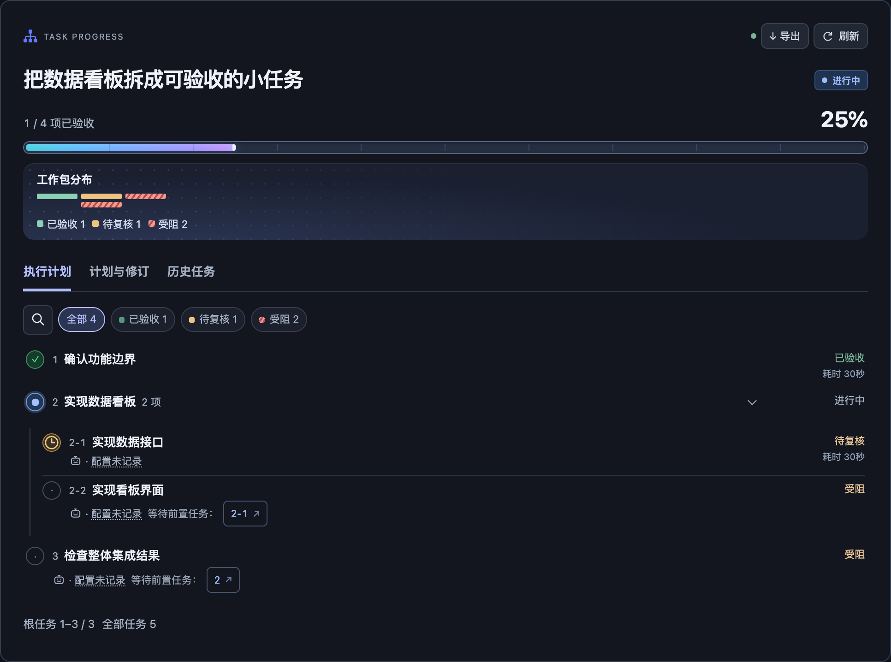

<p align="center">
  
</p>

<p align="center"><strong>Let your agent do the work. Keep the progress in view.</strong></p>
<p align="center">Turn complex work into a task tree. See who's working, what's waiting, and which results have been reviewed.</p>

<p align="center">
  <a href="#get-started"><strong>Get started →</strong></a> ·
  <a href="https://carpe-horam.github.io/task-progress-codex/">Try the interactive demo</a> ·
  <a href="README.md">简体中文</a>
</p>

<p align="center"><sub>Cindy / Codex / DeepSeekRuntime · Task data stored locally · Excel / HTML exports · MIT licensed</sub></p>

## Big tasks. A clear view of the work.

Building a feature, tracking down a stubborn bug, or coordinating several agents takes more than one step. **Task Progress brings the plan, execution records and result reviews into one panel.**

<p align="center">
  <a href="docs/assets/task-progress-preview-0.3.8.png">
    
  </a>
</p>
<p align="center"><sub>0.3.8 real plugin interface · Simulated host and demo data · Click to enlarge.</sub></p>

| What you want to know | What you can inspect |
| --- | --- |
| **Where are we now?** | A task tree with the current executor, status and elapsed time. |
| **What's holding things up?** | Dependencies, waiting reasons and work that remains unresolved. |
| **Has the result been checked?** | Submissions, main-session reviews and supporting evidence, with execution and acceptance tracked separately. |

## Get started

### 1. Install for your host

[Download or check out the v0.3.8 source](https://github.com/carpe-horam/task-progress-codex/releases/tag/v0.3.8). This release contains source code and has no attached installer. Paths below are relative to the extracted or cloned repository.

- **Cindy**: follow the [build guide](plugins/task-progress/cindy/README.md) to stage with `prepare.py --stage`, package the staged directory with Cindy Forge, then install the resulting plugin in Cindy.
- **Codex**: requires plugin and stdio MCP support and Python 3 available as `python` on PATH. Run:

  ```sh
  codex plugin marketplace add carpe-horam/task-progress-codex
  codex plugin add task-progress@task-progress-codex
  ```

  The interactive panel also requires a client with MCP Apps support. Restart Codex; the first connection installs or updates the local service. See [platform requirements](docs/installation.md) (Chinese).
- **DeepSeekRuntime**: choose `plugins/task-progress/dsh` under Plugins → Add plugin → Local directory, or use `plugin_manager` `install_bundle` with its absolute path. Reload the page or restart the app. See the [dsh guide](plugins/task-progress/dsh/README.md).

### 2. Give it a real task

Paste this into your host and replace the text in brackets:

```text
Use Task Progress to help me [describe your task].
Define the plan and acceptance criteria before starting.
Keep progress updated, explain blockers, and review the results
with supporting evidence when the work is finished.
```

### 3. Check in whenever you need to

Ask your agent to **“Open Task Progress.”** The panel refreshes automatically. Expand a task for details, then use **Export** to save Excel and HTML reports.

## From planning to delivery

**Plans change. Execution records stay available.** Break down a task, adjust dependencies, retry a failed step or add a new request along the way. The percentage counts resolved, accepted leaf tasks. At 100%, the main session still reviews the overall delivery.

| From planning to execution | From results to delivery |
| --- | --- |
| **Break down the work**<br>Turn complex goals into dependent subtasks and explore progress by level. | **Review the results**<br>Inspect submissions, acceptance decisions and evidence to find unresolved work. |
| **See the collaboration**<br>Record main-session and subagent assignments and execution attempts. | **Revisit the history**<br>Look back at plan changes, retries and earlier results. |
| **Make room for new requests**<br>Ask your agent to queue independent work or handle it in parallel when conditions allow. | **Take the report with you**<br>Export Excel and HTML for sharing, archiving or a retrospective. |

## Prompts for your next project

| When you're… | Ask your agent… |
| --- | --- |
| **Building a feature** | “Use Task Progress to plan this feature. Confirm the API, implement the UI, then verify the full flow.” |
| **Fixing a bug** | “Track this bug with Task Progress: reproduce, diagnose, fix and verify. Keep evidence for each step.” |
| **Working with several agents** | “Have subagents check the code and docs separately. Record the assignments in Task Progress and have the main session review the results.” |
| **Adding work mid-task** | “Queue the user documentation for after the current task.” |
| **Preparing a handoff** | “Check for unresolved tasks, summarize the acceptance results, then open the progress panel so I can export a report.” |

In Cindy, the Lead delegates approved work to an Orca Worker and reviews its report in the main task tree. Independent requests enter the queue until the Lead activates them. [Cindy Orca Worker workflow](plugins/task-progress/skills/track-progress/references/cindy-orca-worker.md) (Chinese).

## How it fits into your workflow

The host agent plans, executes and coordinates the work. Task Progress saves and displays task state, dependencies and evidence. Task data is stored locally, with separate progress for each session. Each host uses a different integration.

<details>
<summary><strong>Three things to know</strong></summary>

- **Progress reflects recorded work.** The panel updates as the agent writes progress. The plugin does not wake or control host agents, or execute queued tasks on its own.
- **Submission still needs review.** “Awaiting main-session review” means the executor has submitted a result for checking. Finishing execution does not mean every issue is resolved.
- **The host controls presentation.** Cindy uses a plugin panel, Codex uses MCP Apps, and DeepSeekRuntime shows a progress card in the conversation.

See the [execution and responsibility protocol](docs/responsibility-protocol.md) (Chinese) for acceptance contracts, execution attempts and collaboration boundaries.

</details>

## Explore further

[Interactive demo and guide](https://carpe-horam.github.io/task-progress-codex/) · [Installation and service management](docs/installation.md) (Chinese) · [Changelog](CHANGELOG.md) · [Releases](https://github.com/carpe-horam/task-progress-codex/releases) · [Testing](tests/README.md)

If it fits your workflow, **Star the repo** and keep it handy for your next complex task. Real-world [feedback and suggestions](https://github.com/carpe-horam/task-progress-codex/issues) are welcome.

[MIT License](LICENSE)
