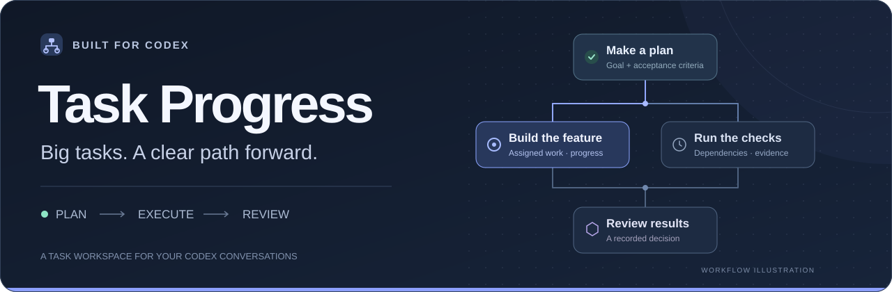
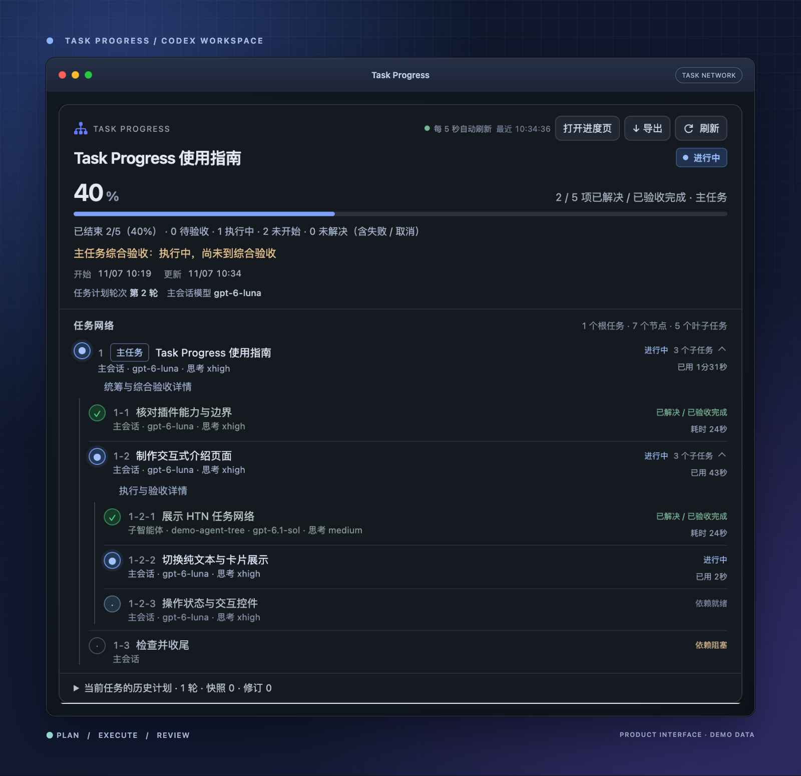

<p align="center">
  
</p>

<p align="center"><strong>Let Codex do the work. Keep the progress in view.</strong></p>
<p align="center">Turn complex work into a task tree. See who's working, what's waiting, and which results have been reviewed.</p>

<p align="center">
  <a href="#get-started"><strong>Get started →</strong></a> ·
  <a href="https://carpe-horam.github.io/task-progress-codex/">Try the interactive demo</a> ·
  <a href="README.md">简体中文</a>
</p>

<p align="center"><sub>Codex plugin · Task data stored locally · Excel / HTML exports · MIT licensed</sub></p>

## Big tasks. A clear view of the work.

Building a feature, tracking down a stubborn bug, or coordinating several agents takes more than one step. **Task Progress brings the plan, execution records and result reviews into one panel.**

<p align="center">
  <a href="docs/assets/task-progress-preview-0.2.22.png">
    
  </a>
</p>
<p align="center"><sub>0.2.22 source interface · Simulated host and demo data · Decorative window frame · Click to enlarge.</sub></p>

| What you want to know | What you can inspect |
| --- | --- |
| **Where are we now?** | A task tree with the current executor, status and elapsed time. |
| **What's holding things up?** | Dependencies, waiting reasons and work that remains unresolved. |
| **Has the result been checked?** | Submissions, main-session reviews and supporting evidence, with execution and acceptance tracked separately. |

## Get started

### 1. Install the plugin

You'll need Codex with plugin and stdio MCP support, plus **Python 3** available as `python` on the Codex process PATH. The interactive panel also requires a client with **MCP Apps** support.

```sh
codex plugin marketplace add carpe-horam/task-progress-codex
codex plugin add task-progress@task-progress-codex
```

**Restart Codex** after installation. The first connection automatically installs or updates the shared local service.

<details>
<summary>Platform requirements and upgrades</summary>

- **macOS**: uses a LaunchAgent for the signed-in user.
- **Linux**: requires a working systemd user session.
- **Windows**: uses Task Scheduler for the signed-in user.

If you only have `python3` or `py`, configure a Python 3 `python` command that Codex can use. For existing installations, follow the [installation and upgrade guide](docs/installation.md) (Chinese), which also covers platform prerequisites, service management and native validation limits.

</details>

### 1b. Install into DeepSeekRuntime (dsh)

The same repository also ships a DeepSeekRuntime bundle at
`plugins/task-progress/dsh`:

- **Desktop**: Plugins → Add plugin → Local directory, then pick that directory.
- **CLI or other clients**: call `plugin_manager` `install_bundle` with that
  directory's absolute path.

The install adds one `task-progress` row (`dsh-task-progress-plugin`) for the
whole profile and keeps it across restarts; reload the page (or restart the app)
once so the panel front end loads. `remove_bundle` uninstalls it without deleting
task data or the background service.

Both hosts share `server.py`, `mcp_bridge.py`, `app.html`, the skill bodies, the
background service and `~/.cache/task-progress`. Only the packaging differs:

| Concern | Codex | DeepSeekRuntime |
| --- | --- | --- |
| Tools | `.mcp.json` starts the stdio MCP server | the bundle registers the same tool names from `tools/list` |
| Skills | manifest `"skills"` | registered into `ctx.skills` at mount |
| Interactive card | MCP Apps resource | in-conversation `render_progress` card with a local MCP Apps proxy |
| Lifecycle hooks | `hooks/hooks.json` | not adapted yet; reminders come from the skill text alone |

`GET /task-progress/status` on the Web origin reports the resolved paths and the
registered tools and skills. Details: [dsh/README.md](plugins/task-progress/dsh/README.md).

### 2. Give it a real task

Paste this into Codex and replace the text in brackets:

```text
Use Task Progress to help me [describe your task].
Define the plan and acceptance criteria before starting.
Keep progress updated, explain blockers, and review the results
with supporting evidence when the work is finished.
```

### 3. Check in whenever you need to

Ask Codex to **“Open Task Progress.”** The panel refreshes automatically. Expand a task for details, then use **Export** to save Excel and HTML reports.

## From planning to delivery

**Plans change. Execution records stay available.** Break down a task, adjust dependencies, retry a failed step or add a new request along the way. Keep the corresponding plans and attempts available for review, with submitted results and accepted outcomes recorded separately.

| From planning to execution | From results to delivery |
| --- | --- |
| **Break down the work**<br>Turn complex goals into dependent subtasks and explore progress by level. | **Review the results**<br>Inspect submissions, acceptance decisions and evidence to find unresolved work. |
| **See the collaboration**<br>Record main-session and subagent assignments and execution attempts. | **Revisit the history**<br>Look back at plan changes, retries and earlier results. |
| **Make room for new requests**<br>Ask Codex to queue independent work or handle it in parallel when conditions allow. | **Take the report with you**<br>Export Excel and HTML for sharing, archiving or a retrospective. |

## Prompts for your next project

| When you're… | Ask Codex… |
| --- | --- |
| **Building a feature** | “Use Task Progress to plan this feature. Confirm the API, implement the UI, then verify the full flow.” |
| **Fixing a bug** | “Track this bug with Task Progress: reproduce, diagnose, fix and verify. Keep evidence for each step.” |
| **Working with several agents** | “Have subagents check the code and docs separately. Record the assignments in Task Progress and have the main session review the results.” |
| **Adding work mid-task** | “Queue the user documentation for after the current task.” |
| **Preparing a handoff** | “Check for unresolved tasks, summarize the acceptance results, then open the progress panel so I can export a report.” |

## How it fits into Codex

Codex plans, executes and coordinates the work. Task Progress saves and displays task state, dependencies and evidence. Task data is stored locally, with separate progress for each session. Behavior is the same in DeepSeekRuntime, where the bundle registers the tools, skills and progress card at mount time.

<details>
<summary><strong>Three things to know</strong></summary>

- **Progress reflects recorded work.** The panel updates as Codex writes progress. The plugin does not wake or control host agents, or execute queued tasks on its own.
- **Submission still needs review.** “Awaiting main-session review” means the executor has submitted a result for checking. Finishing execution does not mean every issue is resolved.
- **The host controls presentation.** The interactive panel requires MCP Apps. It can be requested after the initial plan; the client determines the actual window mode.

See the [execution and responsibility protocol](docs/responsibility-protocol.md) (Chinese) for acceptance contracts, execution attempts and collaboration boundaries.

</details>

## Explore further

[Interactive demo and guide](https://carpe-horam.github.io/task-progress-codex/) · [Installation and service management](docs/installation.md) (Chinese) · [Changelog](CHANGELOG.md) · [Releases](https://github.com/carpe-horam/task-progress-codex/releases) · [Testing](tests/README.md)

If it fits your workflow, **Star the repo** and keep it handy for your next complex task. Real-world [feedback and suggestions](https://github.com/carpe-horam/task-progress-codex/issues) are welcome.

[MIT License](LICENSE)
