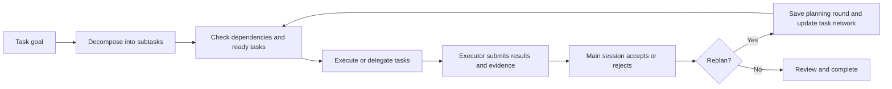

# Task Progress

[简体中文](README.md) | English

Current version: **0.2.0** · [Release and installation notes](docs/releases/0.2.0.md) · [Changelog](CHANGELOG.md)

**Turn multi-step Codex work into a clear, trackable, reviewable task network.**

[](LICENSE)
[](https://carpe-horam.github.io/task-progress-codex/)

Task Progress is a Codex plugin with an interactive task panel, an MCP server, the automatic `track-progress` skill, and `cleanup-task-progress-history`, which runs only when the user explicitly requests cleanup. It helps Codex break complex goals into tasks with dependencies and record progress, results, and evidence. Open the full panel in Codex when you need to review that work.

> [Open the interactive guide and demo](https://carpe-horam.github.io/task-progress-codex/) · [Browse the plugin source](https://github.com/carpe-horam/task-progress-codex/tree/main/plugins/task-progress)

## 0.2.0: progress first, details when needed

Start with a coarse plan and follow dependencies. Queue independent requests or delegate isolated parallel work, then resume the original goal. The main session reviews subagent submissions separately from execution completion.

The panel keeps titles, status, duration and executor visible, with dynamic hierarchy numbers. Expand a task for its result summary, then open execution and review details as needed. The top metadata shows only the planning round and main-session model, with a centered waiting clock.

[](https://carpe-horam.github.io/task-progress-codex/#demo)

*Rendered from this version's app.html in Chrome with synthetic demo data. Try the [interactive guide](https://carpe-horam.github.io/task-progress-codex/#demo); this preview does not establish native Codex host or scheduling behavior.*

## Features

| Feature | Description |
| --- | --- |
| **Plan before substantive work** | Session startup and each new prompt receive a planning reminder. Multi-stage work can submit its initial HTN tree in one call, and the server rejects an unplanned empty root from starting. |
| **Dependencies and parallel work** | Define prerequisites for tasks. Ready tasks can run in parallel when they do not depend on one another. |
| **Delegation and separate acceptance** | Delegate complex work, including sequential handoffs. Preserve planned roles, dispatch bindings, subagent submissions, and main-session reviews separately; pending review blocks dependencies. |
| **Independent requests** | The main session queues unrelated requests or delegates isolated parallel instances without replacing the foreground task. Completing an inserted request does not complete the session. |
| **Recoverable context and replanning** | Persist goals, original requests, constraints, acceptance criteria and resume locations; retain change reasons and evidence when the main session adjusts the plan. |
| **Conversation isolation and history** | Each Codex conversation has its own progress. Starting a new task archives the previous one; replanning rounds and retries are preserved. |
| **Execution and model records** | See the executor and any available model/effort values, with caller-reported and Codex verification status; unknown values are not guessed. |
| **Results and duration** | Review task status, progress, elapsed time, summaries, and acceptance evidence. Details stay collapsed until you open them. |
| **Automatic refresh** | The task panel refreshes every five seconds and also supports manual refresh. |
| **Export execution records** | Export an Excel workbook and a visual HTML report together to `~/Downloads/Task Progress Exports`. |
| **Support for different clients** | MCP Apps clients can display an interactive panel. The model can explicitly query progress and explain the results; the host controls presentation. |

## How it works

Task Progress uses an HTN (Hierarchical Task Network) to represent multi-step work. Parent tasks can be decomposed into subtasks, and dependencies connect related work. Ready tasks without dependencies can run in parallel; tasks with unmet prerequisites wait. Codex hooks provide non-blocking startup reminders, and the server prevents an unplanned empty root from starting. Simple questions need no task tree; a single-step task records an `atomic_reason`.

The main session owns planning and decisions; Task Progress persists details and guides the next action. Corrections stay in the current instance, brief answers return to the original work, and independent requests use `route_request` for a queue or an isolated parallel instance. After the foreground task is truthfully closed, explicitly activate the FIFO head with `activate_request`. Save recovery details through `update_task_context`. See [request routing and recovery](plugins/task-progress/skills/track-progress/references/request-routing.md).

The primary percentage counts resolved leaves accepted under the current protocol. Pending review and execution completion remain distinct, and root synthesis is separate from 100% leaf completion. Missing historical acceptance stays unknown. The plugin does not launch work or wake idle chats. HTML/XLSX exports currently cover the selected task's execution history; request queues and recovery context remain durably available through the API.

Parallel tasks appear as sibling roots after the foreground root in the same task network, in registration order, with their own children and acceptance records. This is a display relationship; instances and dependencies remain isolated. Only a parallel root accepted as resolved by the main session moves from the current network into history. Open, failed and cancelled work stays current. An explicit retry reactivates it while preserving the previous completed record. Unstarted requests stay in the queue, and the headline percentage covers only the foreground task.

The initial view shows titles, status and elapsed time, plus a concise role, bound agent, model and reasoning-effort line. Task context starts collapsed, with any queued request count in its heading. Expanding a task first shows one result summary. Execution, binding, review and evidence remain in a separate, initially closed details section. Refreshes preserve the user's disclosure choices within the current task instance.



<details>
<summary>Execution, delegation and acceptance details</summary>

Complex analysis, implementation, multi-file changes, specialist validation, and review default to subagents even when execution must be sequential. Give a dependency chain to one agent, or assign file owners and serialize their work. The main session plans, dispatches, coordinates, makes cross-task decisions, and accepts results. Short operations or work that genuinely cannot be handed off may run in the main session with a specific `self_execution_reason` (except an explicitly atomic root).

`planned_assignment` preserves the planned executor; starting an attempt cannot silently change its role. Use `reassign_task` with the main session's reason to change a pending leaf. Dispatch follows **start attempt → spawn subagent → bind the returned ID with `bind_task_agent`**. A subagent submits through `update_task`, producing `awaiting_review`; the main session separately accepts or rejects it through `review_task`. Pending review blocks every dependency policy. Accepting an open result leaves it open. Group/root acceptance requires all direct children resolved, no pending reviews, and a main-session summary with evidence.

The plugin stores plans, dispatches, submissions and reviews and validates workflow transitions. It does not create subagents. Roles, agent IDs, and reviewers are caller-reported; HTTP credentials do not authenticate a particular main session or subagent, and instance/attempt IDs are not authorization credentials. The plugin cannot intercept work through other tools. Missing role or acceptance information in legacy records stays unrecorded. See the [responsibility protocol](docs/responsibility-protocol.md) and [execution workflow](plugins/task-progress/skills/track-progress/SKILL.md).

For long-running work, the skill asks Codex to consider breaking down any individual task that runs for more than 10 minutes. It only creates smaller, independently verifiable tasks when that would improve execution or progress visibility.

</details>

## Installation

### First install of 0.2.0 (macOS)

Install the `v0.2.0` release tag independently of the default branch. Requires Python 3 and a Codex CLI/client with plugin, Streamable HTTP and `http_headers_helper` support.

```sh
codex plugin marketplace add carpe-horam/task-progress-codex --ref v0.2.0
codex plugin add task-progress@task-progress-codex
python3 "${CODEX_HOME:-$HOME/.codex}/plugins/cache/task-progress-codex/task-progress/0.2.0/service_manager.py" install
```

Restart Codex afterwards. Installing the plugin does not start the background service by itself; the last command is required. Use a stable Python 3 installation, as the service stores the interpreter's absolute path.

### Upgrade an existing installation to 0.2.0

Register the fixed release source again, reinstall the plugin and service, then restart Codex:

```sh
codex plugin marketplace remove task-progress-codex
codex plugin marketplace add carpe-horam/task-progress-codex --ref v0.2.0
codex plugin add task-progress@task-progress-codex
python3 "${CODEX_HOME:-$HOME/.codex}/plugins/cache/task-progress-codex/task-progress/0.2.0/service_manager.py" install
```

This removes and re-adds the Marketplace registration. Task data stays in its separate local cache and needs no migration. Restart Codex to release old stdio processes. Refreshing Marketplace metadata alone does not update the installed plugin or background service. If the Marketplace is not registered yet, use the first-install commands instead.

### Install from a local clone

```sh
git clone --branch v0.2.0 --depth 1 https://github.com/carpe-horam/task-progress-codex.git
codex plugin marketplace add ./task-progress-codex
codex plugin add task-progress@task-progress-codex
python3 ./task-progress-codex/plugins/task-progress/service_manager.py install
```

Restart Codex afterwards. If the Marketplace name already exists, remove that registration before adding the local source. Updating the clone also requires reinstalling the plugin and service.

### Shared background service (macOS)

All local Codex chats connect directly to `http://127.0.0.1:53421/mcp`, sharing **one Python service process**. Client connections and UI tabs remain independent, and task data is separated by `session_id`; requests can execute concurrently. The user LaunchAgent `io.task-progress.mcp` starts at login and restarts the daemon after a crash. There is no Python proxy process per chat.

Runtime files live in `~/Library/Application Support/Task Progress/releases/`, independently of replaceable plugin caches. Credentials live in `~/.cache/task-progress/service/http-headers.json`, with directory mode 0700 and file mode 0600. Codex briefly runs `http_headers_helper` to read them. The service binds only to loopback, validates Host and Bearer credentials, and rejects browser cross-origin requests.

Manage the service from a local clone:

```sh
python3 plugins/task-progress/service_manager.py status --json
python3 plugins/task-progress/service_manager.py install   # Install, upgrade, or start a stopped service
python3 plugins/task-progress/service_manager.py stop      # Affects every chat using the service
python3 plugins/task-progress/service_manager.py uninstall # Preserve tasks, credentials, and releases
```

Existing stdio chats may retain their old processes until Codex restarts. The installer does not terminate those chats. If an unrelated service occupies the port, installation fails without stopping that process. Logs are in `~/.cache/task-progress/service/service.{stdout,stderr}.log`.

Automatic background management currently supports macOS. On Linux, run `service_manager.py prepare`, then `shared_service.py`, and configure your own user service. Windows background management and client credential helpers have not been verified.

## Getting started

After installing and enabling the plugin, Codex receives a reminder to plan before substantive work at session startup and on each new prompt. If Codex reviews and trusts the plugin hooks, the host lifecycle hooks provide those reminders. Multi-stage work can submit its coarse plan in the same `init_task_network` call, and the server rejects an unplanned empty root from starting. For example:

> Break this issue into implementation and verification steps based on their dependencies, and keep the task progress up to date.

You can also explicitly ask Codex to use Task Progress. Updates return identity/status receipts; the model explicitly queries progress when needed. After creating the first task and recording its coarse plan, the main session calls `render_progress` once to request a progress page automatically. It returns bootstrap identity and a one-time display intent; the panel reads its own data. The resource prefers fullscreen so supporting hosts can choose it before JavaScript mounts. A mounted app consumes only the latest intent and checks host capabilities before requesting a mode change. Ordinary updates, queries, resume and polling do not render again; closing or declining does not trigger automatic reopening. The user can use the open-page button or explicitly request reopening. The host determines actual presentation; a tool receipt does not prove a visible tab. When a fullscreen tab opens, the inline card is temporarily hidden and returns after that tab closes. Cards from older task results collapse so they cannot show stale progress. The public MCP Apps context currently does not define a historical or archived conversation flag, so the plugin cannot reliably detect and proactively hide cards already saved in historical conversations. The main-session panel shows the current task network, execution status, completion percentage, summaries, and planning history. Title prefixes such as `1`, `1-1`, and `2-2-1` reflect the current hierarchy and stable dependency order. They recompute after insertion, reordering, hierarchy changes or replanning, without changing task IDs. Main and parallel roots follow their panel order; numbering does not require parallel branches to execute serially. History uses its own snapshot order. Use **Refresh** to sync the latest status, or **Export** to save the current task as an Excel workbook and HTML report. Subagents working in the main session's task tree update only their assigned nodes and do not open another main-session panel.

Default behavior:

- Multi-step tasks use an HTN task network. The linear-step mode is reserved for workflows explicitly requested as linear or for resuming an existing legacy task.
- A new multi-stage task starts with at least two coarse tasks that have distinct result boundaries. A single-step task records a specific `atomic_reason`. An unplanned empty root is never ready and cannot start.
- Reuse the same `session_id` within a conversation. Starting a new task moves the previous task into history.
- Use a new planning round when the task network needs to change. Retries keep a separate record for each attempt.
- Do not guess an unknown model or reasoning effort; unknown values are shown as “Not recorded.” Caller-supplied values include a capture time and are labeled as unverified by the Codex host.

<details>
<summary>Developer reference: selective queries and pagination</summary>

## Selective queries

Mutation receipts put identity fields such as `session_id`, `task_instance_id`, `root_id` and `epoch` at the top of `structuredContent`. A started attempt returns top-level `attempt_id`; `affected` holds the single target's status. Receipts contain no tree, summaries, evidence or request bodies. Use `request_task_instance_id` for the new instance after registering parallel work.

`get_progress` returns view metadata in `structuredContent` and data in `structuredContent.progress`:

| Need | View and parameters |
|---|---|
| Overview and counts (default) | `overview`; no complete context or nodes |
| One or more subtree levels | `tree`, `task_id`, `depth=0..8`; breadth-first pagination; check `depth_limited` and title truncation |
| Specific current nodes and submission evidence | `tasks`, `task_ids` (1–20); excludes append-only record arrays |
| Node records | `records`, `task_id`, `record_kind=attempts/invalidated_results/reassignment_history` |
| Recovery context and paginated requests | `context`; includes `task_context` and `session_work` |
| One history category | `history`, `history_kind=history/task_history/context_revisions/legacy_history` |
| Complete selected instance | Explicit `full`, or compatible `include_history=true` (cannot be combined with other views) |

Pages use `offset`, `limit` (default 50, maximum 200) and returned `pagination.has_more/next_offset`. Pin the first page's `state_revision` as `expected_state_revision` on later pages; restart at page one if it changes. Resume with overview → context → needed tree/tasks. Query a node's submission/evidence before acceptance; a receipt is insufficient. Before concluding, read all context request pages. Do not read full after every write.

Full preserves the selected JSON instance, records, archives and complete session request registry. Peers contain compact current snapshots; read each peer instance separately for its history. Legacy SQLite remains a bounded read-only excerpt, not a complete database. `get_ready_tasks` returns only paginated `structuredContent.ready_tasks`; dependency summaries/evidence are deduplicated by ID in `dependency_evidence[id]`, without a whole tree.

Old messages do not shrink retroactively. Reopen old iframes to load the new resource. Measured UTF-8 bytes are neither tokens nor native Codex message-expansion timing.

</details>

## Data and requirements

- The MCP server uses authenticated local HTTP shared by chats belonging to the same OS user. Current tasks remain under `~/.cache/task-progress/sessions`. Records in the retired `progress-v3.sqlite3` store appear as a separate read-only archive excerpt; they do not overwrite current state or require migration, and are not uploaded with this repository.
- Writes return identity/status receipts only. Reads default to overview; nodes, records, context and history are queried on demand. The panel independently uses app-only `get_progress_view` for polling, lazy records and exports; the model should not call that App tool. Execution ended, awaiting review, and resolved remain separate: 100% execution ended does not mean delivery accepted.
- Continue or re-plan the same task for another phase of its goal. Initializing a new goal cannot archive running or pending-review work; replacing other unfinished work requires an explicit reason.
- Python 3 and a Codex client supporting Streamable HTTP and `http_headers_helper` are required. Automatic service installation currently targets macOS. The `server.py` stdio entry point remains for compatibility and isolated testing; the default plugin connection no longer launches it.
- Exported `.xlsx` and `.html` files are written to `~/Downloads/Task Progress Exports`.
- Task Progress records and displays work status. Actual Codex model execution uses the user's own Codex account and service connection.

## Regression checks

Retries invalidate downstream results and related acceptances while preserving attempt history for inspection in the card. Automatic refresh preserves focus, selection and reading position, reports synchronization failures, and follows the host's light/dark theme.

Leaf tasks and linear steps must start before they can be marked complete. After clearing a session, new task writes require `task_instance_id` so delayed requests cannot alter the replacement task. Exports label invalidated attempts and distinguish group acceptance from cancellation/failure closure.

Run `python3 -m unittest discover -s tests -v` for backend regressions. Run `node tests/test_app.cjs` with an existing Playwright installation and Chrome for browser checks against a simulated MCP Apps host. See [test instructions](tests/README.md).

Clearing a session deletes its progress, task history, and view registration. Content-free ordering counters remain so late responses cannot restore deleted tasks or supersede newer ones.

## Project structure

```text
.
├── .agents/plugins/marketplace.json    # Codex Marketplace manifest
├── docs/index.html                     # GitHub Pages interactive guide
└── plugins/task-progress/
    ├── .codex-plugin/plugin.json       # Plugin manifest
    ├── .mcp.json                       # Local MCP server configuration
    ├── app.html                        # Interactive task progress UI
    ├── server.py                       # MCP server and local progress storage
    ├── shared_service.py               # Shared authenticated HTTP service
    ├── service_manager.py              # User background service management
    ├── skills/track-progress/          # Automatic planning and tracking rules
    └── skills/cleanup-task-progress-history/  # Explicit cleanup for archived sessions
```

## FAQ

**I added the plugin, but it does not appear in Codex.** Reload or restart Codex, then install the plugin from **Plugins Directory**. Adding a marketplace only registers its source; it does not install the plugins in it.

**Why don't I see an interactive task card?** The card requires client support for MCP Apps. Clients without that support still receive a plain-text progress summary.

**Will the plugin create or schedule subagents for me?** No. The plugin represents task hierarchy, dependencies, and dispatch records. The Codex main session creates and coordinates subagents.

**Is my task progress uploaded to the repository?** No. The repository contains the plugin and its guide; runtime progress stays in the local user cache. Records leave the device only if you explicitly export or share them.

## Links

- [Task Progress interactive guide](https://carpe-horam.github.io/task-progress-codex/)
- [GitHub repository and issue tracker](https://github.com/carpe-horam/task-progress-codex)
- [Task Progress plugin source](https://github.com/carpe-horam/task-progress-codex/tree/main/plugins/task-progress)

## License

This project is licensed under the MIT License. See [LICENSE](LICENSE).

Display-mode protocol: [OpenAI resource preferences](https://github.com/openai/mcp-extensions/blob/main/docs/spec.md#display-modes), [MCP Apps host capabilities and resulting modes](https://github.com/modelcontextprotocol/ext-apps/blob/main/specification/2026-01-26/apps.mdx#display-modes). The new resource uses v4; legacy v2/v3 retain inline preference. A host may create a historical/duplicate fullscreen surface before app code runs; the app can only request demotion after mounting. Native host visibility requires separate acceptance.
