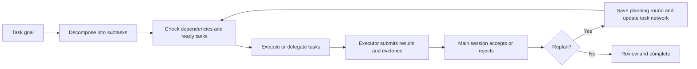

# Task Progress

[简体中文](README.md) | English

Current version: **0.2.0** · [Changelog](CHANGELOG.md)

**Turn multi-step Codex work into a clear, trackable, reviewable task network.**

[](LICENSE)
[](https://carpe-horam.github.io/task-progress-codex/)

Task Progress is a Codex plugin with an interactive task panel, an MCP server, the automatic `track-progress` skill, and `cleanup-task-progress-history`, which runs only when the user explicitly requests cleanup. It helps Codex break complex goals into tasks with dependencies and record progress, results, and evidence. Open the full panel in Codex when you need to review that work.

> [Open the interactive guide and demo](https://carpe-horam.github.io/task-progress-codex/) · [Browse the plugin source](https://github.com/carpe-horam/task-progress-codex/tree/main/plugins/task-progress)

## Animated demo

[](https://carpe-horam.github.io/task-progress-codex/#demo)

## Features

| Feature | Description |
| --- | --- |
| **Plan before substantive work** | Session startup and each new prompt receive a planning reminder. Multi-stage work can submit its initial HTN tree in one call, and the server rejects an unplanned empty root from starting. |
| **Dependencies and parallel work** | Define prerequisites for tasks. Ready tasks can run in parallel when they do not depend on one another. |
| **Delegation and separate acceptance** | Delegate complex work, including sequential handoffs. Preserve planned roles, dispatch bindings, subagent submissions, and main-session reviews separately; pending review blocks dependencies. |
| **Conversation isolation and history** | Each Codex conversation has its own progress. Starting a new task archives the previous one; replanning rounds and retries are preserved. |
| **Execution and model records** | See the executor and any available model/effort values, with caller-reported and Codex verification status; unknown values are not guessed. |
| **Results and duration** | Review task status, progress, elapsed time, summaries, and acceptance evidence. Details stay collapsed until you open them. |
| **Automatic refresh** | The task panel refreshes every five seconds and also supports manual refresh. |
| **Export execution records** | Export an Excel workbook and a visual HTML report together to `~/Downloads/Task Progress Exports`. |
| **Support for different clients** | Clients that support MCP Apps display an interactive task card. Other clients receive a readable plain-text progress summary. |

## How it works

Task Progress uses an HTN (Hierarchical Task Network) to represent multi-step work. Parent tasks can be decomposed into subtasks, and dependencies connect related work. Ready tasks without dependencies can run in parallel; tasks with unmet prerequisites wait. Codex hooks provide non-blocking startup reminders, and the server prevents an unplanned empty root from starting. Simple questions need no task tree; a single-step task records an `atomic_reason`.



Complex analysis, implementation, multi-file changes, specialist validation, and review default to subagents even when execution must be sequential. Give a dependency chain to one agent, or assign file owners and serialize their work. The main session plans, dispatches, coordinates, makes cross-task decisions, and accepts results. Short operations or work that genuinely cannot be handed off may run in the main session with a specific `self_execution_reason` (except an explicitly atomic root).

`planned_assignment` preserves the planned executor; starting an attempt cannot silently change its role. Use `reassign_task` with the main session's reason to change a pending leaf. Dispatch follows **start attempt → spawn subagent → bind the returned ID with `bind_task_agent`**. A subagent submits through `update_task`, producing `awaiting_review`; the main session separately accepts or rejects it through `review_task`. Pending review blocks every dependency policy. Accepting an open result leaves it open. Group/root acceptance requires all direct children resolved, no pending reviews, and a main-session summary with evidence.

The plugin stores plans, dispatches, submissions and reviews and validates workflow transitions. It does not create subagents. Roles, agent IDs, and reviewers are caller-reported; HTTP credentials do not authenticate a particular main session or subagent, and instance/attempt IDs are not authorization credentials. The plugin cannot intercept work through other tools. Missing role or acceptance information in legacy records stays unrecorded. See the [responsibility protocol](docs/responsibility-protocol.md) and [execution workflow](plugins/task-progress/skills/track-progress/SKILL.md).

For long-running work, the skill asks Codex to consider breaking down any individual task that runs for more than 10 minutes. It only creates smaller, independently verifiable tasks when that would improve execution or progress visibility.

## Installation

### Install from the GitHub Marketplace

Add this marketplace from a terminal:

```sh
codex plugin marketplace add carpe-horam/task-progress-codex
codex plugin add task-progress@task-progress-codex
python3 "${CODEX_HOME:-$HOME/.codex}/plugins/cache/task-progress-codex/task-progress/0.2.0/service_manager.py" install
```

You can also install **Task Progress** from **Plugins Directory**, then run `service_manager.py install` above. Since 0.2.0, all chats connect to one user-level background service; installing the plugin alone does not start that service. Restart Codex after installation.

### Install from a local clone

```sh
git clone https://github.com/carpe-horam/task-progress-codex.git
codex plugin marketplace add ./task-progress-codex
python3 ./task-progress-codex/plugins/task-progress/service_manager.py install
codex plugin add task-progress@task-progress-codex
```

Restart Codex after installation. Run the installer using a stable Python 3 installation; the background service records its absolute interpreter path.

### Update the plugin

For a GitHub Marketplace installation, refresh the marketplace snapshot:

```sh
codex plugin marketplace upgrade task-progress-codex
```

For a local clone, pull the latest version from the repository:

```sh
cd task-progress-codex
git pull --ff-only origin main
```

After refreshing the source, reinstall the plugin, run `service_manager.py install` from the new installed version (or the updated local clone), then restart Codex. The installer reuses an identical release or switches to a new runtime directory, restoring the previous installation if health checks fail. Refreshing the marketplace alone does not update the installed plugin or background service.

### Shared background service (macOS)

All local Codex chats connect directly to `http://127.0.0.1:53421/mcp`, sharing **one Python service process**. Client connections and UI tabs remain independent, and task data is separated by `session_id`; requests can execute concurrently. The user LaunchAgent `io.task-progress.mcp` starts at login and restarts the daemon after a crash. There is no Python proxy process per chat.

Runtime files live in `~/Library/Application Support/Task Progress/releases/`, independently of replaceable plugin caches. Credentials live in `~/.cache/task-progress/service/http-headers.json`, with directory mode 0700 and file mode 0600. Codex briefly runs `http_headers_helper` to read them. The service binds only to loopback, validates Host and Bearer credentials, and rejects browser cross-origin requests.

Manage the service from a local clone:

```sh
python3 plugins/task-progress/service_manager.py status --json
python3 plugins/task-progress/service_manager.py install   # Install, upgrade, or start a stopped service
python3 plugins/task-progress/service_manager.py stop      # Affects every chat using the service
python3 plugins/task-progress/service_manager.py uninstall # Preserve tasks, credentials, and releases
```

Existing stdio chats may retain their old processes until Codex restarts. The installer does not terminate those chats. If an unrelated service occupies the port, installation fails without stopping that process. Logs are in `~/.cache/task-progress/service/service.{stdout,stderr}.log`.

Automatic background management currently supports macOS. On Linux, run `service_manager.py prepare`, then `shared_service.py`, and configure your own user service. Windows background management and client credential helpers have not been verified.

## Getting started

After installing and enabling the plugin, Codex receives a reminder to plan before substantive work at session startup and on each new prompt. If Codex reviews and trusts the plugin hooks, the host lifecycle hooks provide those reminders. Multi-stage work can submit its coarse plan in the same `init_task_network` call, and the server rejects an unplanned empty root from starting. For example:

> Break this issue into implementation and verification steps based on their dependencies, and keep the task progress up to date.

You can also explicitly ask Codex to use Task Progress. The main session calls `render_progress` once; the full progress view appears inline in the conversation by default. Ordinary task updates change the data without repeatedly opening the panel. When the user switches the panel to a fullscreen tab, the inline card is temporarily hidden and returns after that tab closes. Cards from older task results collapse so they cannot show stale progress. The public MCP Apps context currently does not define a historical or archived conversation flag, so the plugin cannot reliably detect and proactively hide cards already saved in historical conversations. The main-session panel shows the current task network, execution status, completion percentage, summaries, and planning history. Use **Refresh** to sync the latest status, or **Export** to save the current task as an Excel workbook and HTML report. Subagents working in the main session's task tree update only their assigned nodes and do not open another main-session panel.

Default behavior:

- Multi-step tasks use an HTN task network. The linear-step mode is reserved for workflows explicitly requested as linear or for resuming an existing legacy task.
- A new multi-stage task starts with at least two coarse tasks that have distinct result boundaries. A single-step task records a specific `atomic_reason`. An unplanned empty root is never ready and cannot start.
- Reuse the same `session_id` within a conversation. Starting a new task moves the previous task into history.
- Use a new planning round when the task network needs to change. Retries keep a separate record for each attempt.
- Do not guess an unknown model or reasoning effort; unknown values are shown as “Not recorded.” Caller-supplied values include a capture time and are labeled as unverified by the Codex host.

## Data and requirements

- The MCP server uses authenticated local HTTP shared by chats belonging to the same OS user. Task progress remains under `~/.cache/task-progress/sessions` without migration; it is not uploaded with this repository or shared with other users.
- Python 3 and a Codex client supporting Streamable HTTP and `http_headers_helper` are required. Automatic service installation currently targets macOS. The `server.py` stdio entry point remains for compatibility and isolated testing; the default plugin connection no longer launches it.
- Exported `.xlsx` and `.html` files are written to `~/Downloads/Task Progress Exports`.
- Task Progress records and displays work status. Actual Codex model execution uses the user's own Codex account and service connection.

## Regression checks

Retries invalidate downstream results and related acceptances while preserving attempt history for inspection in the card. Automatic refresh preserves focus, selection and reading position, reports synchronization failures, and follows the host's light/dark theme.

Leaf tasks and linear steps must start before they can be marked complete. After clearing a session, new task writes require `task_instance_id` so delayed requests cannot alter the replacement task. Exports label invalidated attempts and distinguish group acceptance from cancellation/failure closure.

Run `python3 -m unittest discover -s tests -v` for backend regressions. Run `node tests/test_app.cjs` with an existing Playwright installation and Chrome for browser checks against a simulated MCP Apps host. See [test instructions](tests/README.md).

Clearing a session deletes its progress, task history, and view registration. Content-free ordering counters remain so late responses cannot restore deleted tasks or supersede newer ones.

## Project structure

```text
.
├── .agents/plugins/marketplace.json    # Codex Marketplace manifest
├── docs/index.html                     # GitHub Pages interactive guide
└── plugins/task-progress/
    ├── .codex-plugin/plugin.json       # Plugin manifest
    ├── .mcp.json                       # Local MCP server configuration
    ├── app.html                        # Interactive task progress UI
    ├── server.py                       # MCP server and local progress storage
    ├── shared_service.py               # Shared authenticated HTTP service
    ├── service_manager.py              # User background service management
    ├── skills/track-progress/          # Automatic planning and tracking rules
    └── skills/cleanup-task-progress-history/  # Explicit cleanup for archived sessions
```

## FAQ

**I added the plugin, but it does not appear in Codex.** Reload or restart Codex, then install the plugin from **Plugins Directory**. Adding a marketplace only registers its source; it does not install the plugins in it.

**Why don't I see an interactive task card?** The card requires client support for MCP Apps. Clients without that support still receive a plain-text progress summary.

**Will the plugin create or schedule subagents for me?** No. The plugin represents task hierarchy, dependencies, and dispatch records. The Codex main session creates and coordinates subagents.

**Is my task progress uploaded to the repository?** No. The repository contains the plugin and its guide; runtime progress stays in the local user cache. Records leave the device only if you explicitly export or share them.

## Links

- [Task Progress interactive guide](https://carpe-horam.github.io/task-progress-codex/)
- [GitHub repository and issue tracker](https://github.com/carpe-horam/task-progress-codex)
- [Task Progress plugin source](https://github.com/carpe-horam/task-progress-codex/tree/main/plugins/task-progress)

## License

This project is licensed under the MIT License. See [LICENSE](LICENSE).
