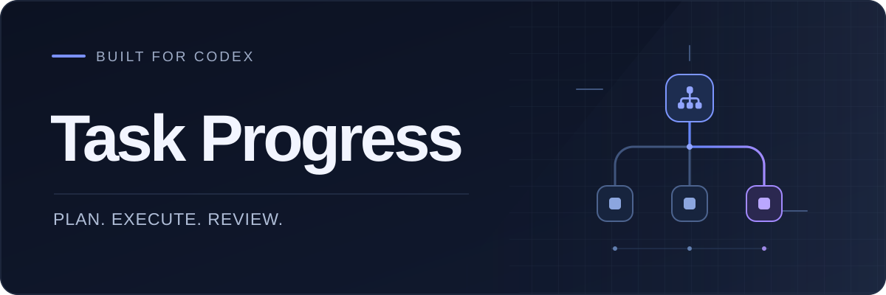
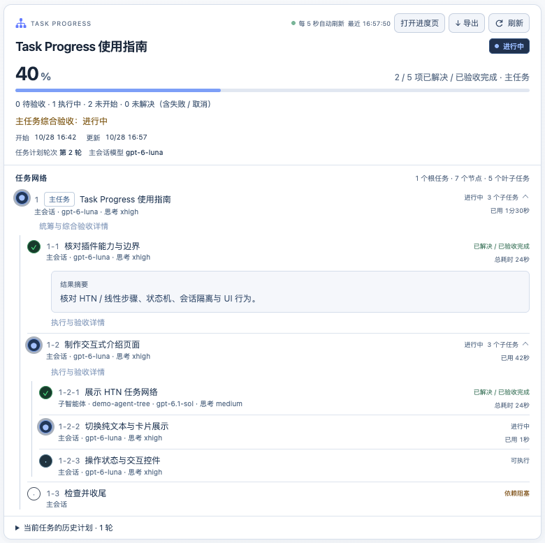

<p align="center">
  
</p>

<p align="center">简体中文 · <a href="README.en.md">English</a></p>

<p align="center"><strong>让 Codex 的多步骤任务进展一目了然。</strong></p>
<p align="center">计划、执行与验收，在同一个任务面板中。</p>

<p align="center">
  <a href="https://carpe-horam.github.io/task-progress-codex/">交互演示</a> ·
  <a href="https://github.com/carpe-horam/task-progress-codex/releases/tag/v0.2.2">安装 0.2.2</a> ·
  <a href="CHANGELOG.md">更新记录</a>
</p>

## 主要功能

| 看清当前进展 | 有序推进复杂工作 |
| --- | --- |
| 层级编号、状态、执行者与耗时一目了然，展开查看结果。 | 跟踪任务拆分、依赖与并行，计划变化时同步更新。 |
| **接住临时请求**<br>让 Codex 将独立请求排队或并行处理，保留原任务进度。 | **回看结果与证据**<br>保留验收、历史和重试记录，导出 Excel 与 HTML 报告。 |

## 安装

macOS、Linux、Windows 需要支持插件与 stdio MCP 的 Codex，以及在 Codex 进程的 PATH 中可通过 `python` 启动的 Python 3。在终端执行：

```sh
codex plugin marketplace add carpe-horam/task-progress-codex
codex plugin add task-progress@task-progress-codex
```

Task Progress 0.2.2 首次连接时自动安装或更新本机共享后台服务。安装后**重启 Codex**。每个连接保留一个轻量 stdio→HTTP 桥接进程，任务仍由共享服务处理。macOS 使用 LaunchAgent，Linux 需要可用的 systemd 用户会话，Windows 使用当前登录用户的任务计划程序。平台前提见[安装与升级文档](docs/installation.md)。

## 开始使用

直接在 Codex 中描述任务：

> 用 Task Progress 帮我规划并实现这个功能，持续更新任务进度，完成后检查结果。

| 想做什么 | 可以这样说 |
| --- | --- |
| 查看进度 | “打开任务进度。” |
| 调整计划 | “先完成接口，再做界面，更新任务顺序。” |
| 插入任务 | “把整理文档加入队列，当前任务完成后再做。” |
| 并行处理 | “让子智能体并行检查文档，主任务继续。” |

0.2.1 支持移交验收归档：把并行任务剩余工作绑定到精确的承接尝试，验收后收尾；含取消子项的父任务由主会话决定继续或接受收尾。原 open/cancelled、尝试与验收历史保留，重试可以重新展开工作，HTML/Excel 同时保留审计证据。

面板自动刷新，点击任务查看详情，点击“导出”保存报告。“待主会话验收”表示结果已提交、仍需检查。Codex 负责实际执行与协调，Task Progress 记录和展示，数据保存在本机；插件不会自动唤醒或控制宿主 agent。交互面板需要客户端支持 MCP Apps。

<details>
<summary><strong>查看任务面板</strong> · 0.2.0 历史预览，演示数据</summary>



</details>

## 更多资料

[交互手册](https://carpe-horam.github.io/task-progress-codex/) · [安装与服务管理](docs/installation.md) · [反馈问题](https://github.com/carpe-horam/task-progress-codex/issues) · [执行协议](docs/responsibility-protocol.md) · [测试说明](tests/README.md)

[MIT License](LICENSE)
