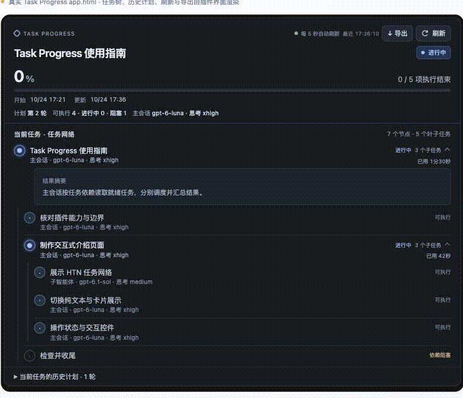
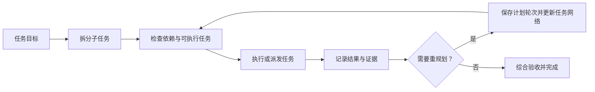

# Task Progress

简体中文 | [English](README.en.md)

**把 Codex 的多步骤工作变成清楚、可追踪、可复盘的任务网络。**

[](LICENSE)
[](https://carpe-horam.github.io/task-progress-codex/)

Task Progress 是一个 Codex 插件，包含交互式任务面板、MCP 服务和 `track-progress` skill。它帮助 Codex 把复杂目标拆成有依赖关系的任务，记录执行进度、结果与证据，并在 Codex 中持续展示。

> [打开交互式宣传手册与功能演示](https://carpe-horam.github.io/task-progress-codex/) · [查看插件源码](https://github.com/carpe-horam/task-progress-codex/tree/main/plugins/task-progress)

## 效果图与动态演示

[](https://carpe-horam.github.io/task-progress-codex/#demo)

## 能做什么

| 能力 | 说明 |
| --- | --- |
| **自动规划多步骤任务** | Codex 主会话或 agent 遇到两个及以上步骤时，默认使用 HTN 任务网络跟踪；不需要在每个项目里重复配置规则。 |
| **表达依赖与并行** | 标记任务前置条件。依赖已满足的任务可执行，同一批互不依赖的任务可以并行推进。 |
| **按会话隔离与保存历史** | 每个 Codex 会话有独立进度；同一会话开始新任务后，旧任务归档到历史。重规划轮次和重试记录也会保留。 |
| **记录执行者与模型** | 展示主会话或子智能体、实际模型和思考强度，帮助回顾任务由谁、以什么配置完成。 |
| **查看结果与耗时** | 汇总任务状态、进度、持续时间、结果摘要与验收证据；详情默认收起，按需展开。 |
| **自动刷新** | 任务面板每 5 秒刷新一次，也可手动刷新。 |
| **导出执行记录** | 一键同时导出 Excel 工作簿和可视化 HTML，保存到本机 `Downloads/Task Progress Exports`。 |
| **适配不同客户端** | 支持 MCP Apps 的客户端显示交互式卡片；不支持卡片的客户端会收到可读的纯文本进度摘要。 |

## 工作方式

Task Progress 默认用 HTN（分层任务网络）表达多步骤工作：父任务可以继续拆分，子任务通过依赖关系连接。没有依赖关系的 ready 任务可以并行；有前置条件的任务会等待。



插件负责保存任务网络、派发信息、状态、结果和证据；Codex 主会话负责实际执行、创建子智能体、协调并验收结果。记录了子智能体任务不等于插件自动创建了子智能体。

长任务也更容易检查：单个任务执行超过 10 分钟时，skill 会要求 Codex 评估是否有必要拆成更细、可独立检查的任务；只有确实能改善执行或进度可见性时才拆分。

## 安装

### 从 GitHub Marketplace 安装

在终端添加此 Marketplace：

```sh
codex plugin marketplace add carpe-horam/task-progress-codex
```

然后在 Codex 桌面端打开 **Plugins Directory**，找到 **Task Progress** 并安装。如果插件目录尚未更新，重载或重启 Codex 后再查看。

### 从本地克隆安装

```sh
git clone https://github.com/carpe-horam/task-progress-codex.git
codex plugin marketplace add ./task-progress-codex
```

然后在 **Plugins Directory** 中安装 **Task Progress**。

## 开始使用

安装并启用插件后，直接让 Codex 处理多步骤工作即可，skill 会自动跟踪任务。例如：

> 请梳理这个问题，按依赖拆分实现和验证步骤，并持续更新任务进度。

你也可以明确要求 Codex 使用 Task Progress。进度面板会显示当前任务网络、执行状态、完成比例、任务摘要和历史计划。点击“刷新”可立即同步状态；点击“导出”可将当前任务记录保存为 Excel 与 HTML 文件。

默认规则：

- 多步骤任务使用 HTN 任务网络；线性步骤模式仅用于用户明确要求线性流程或恢复旧版任务。
- 同一会话复用 session ID；开始新任务时，当前任务进入历史记录。
- 同一任务需要调整方案时，使用重规划轮次；重试会保留新的执行尝试记录。
- 重试会使依赖旧结果的下游及相关验收失效，必须重新执行或验收；卡片可展开查看保留的执行记录。
- 叶任务和顺序步骤必须先启动再标记完成；清空会话后，新任务的写入必须携带 `task_instance_id`，避免迟到请求污染新任务。
- 导出会标明旧执行记录是否已失效，并区分分组验收与取消/失败收尾。
- 自动刷新保留键盘焦点、文本选择和阅读位置，显示同步失败及恢复状态；卡片适配窄窗口和宿主明暗主题。
- 对不确定的模型或思考强度不猜测；未知值会显示为未记录。

## 数据与运行要求

- MCP 服务通过本机 stdio 启动。任务进度保存在当前用户设备的 `~/.cache/task-progress/sessions`，不会随着 GitHub 仓库上传或与其他用户共享。
- 运行 MCP 服务需要 Python 3。当前 `.mcp.json` 启动配置面向 macOS/Linux；仓库包含 Windows 启动器，但 Windows MCP 配置尚未验证。
- 导出的 `.xlsx` 与 `.html` 文件写入当前用户的 `~/Downloads/Task Progress Exports`。
- Task Progress 记录与展示工作状态；Codex 的实际模型运行仍由用户自己的 Codex 账号和服务连接提供。
- 清除任务会删除当前进度、任务历史和视图登记；只保留不含任务内容的顺序计数器，防止迟到响应恢复已清除内容或替换新任务。

## 开发验证

后端回归使用 Python 标准库：`python3 -m unittest discover -s tests -v`。浏览器回归运行真实前端、隔离服务端与模拟 MCP Apps 宿主，需已有 Playwright 和 Chrome：`node tests/test_app.cjs`。详见 [测试说明](tests/README.md)。

## 项目结构

```text
.
├── .agents/plugins/marketplace.json    # Codex Marketplace 清单
├── docs/index.html                     # GitHub Pages 交互式宣传手册
└── plugins/task-progress/
    ├── .codex-plugin/plugin.json       # 插件清单
    ├── .mcp.json                       # 本机 MCP 服务配置
    ├── app.html                        # 交互式任务进度界面
    ├── server.py                       # MCP 服务与本地进度存储
    └── skills/track-progress/          # 自动规划与跟踪规则
```

## 常见问题

**插件已添加，但 Codex 里没有显示？** 先重载或重启 Codex，再从 **Plugins Directory** 安装插件。添加 Marketplace 只登记来源，不会自动安装其中的插件。

**为什么没有交互卡片？** 卡片依赖客户端对 MCP Apps 的支持。客户端不支持时，Task Progress 仍会返回纯文本进度摘要。

**插件会替我创建或调度子智能体吗？** 不会。插件表示任务层级、依赖和派发记录；实际创建与协调子智能体由 Codex 主会话完成。

**我的任务进度会上传到仓库吗？** 不会。仓库发布的是插件代码和宣传手册；运行时进度保存在本机用户缓存中。只有你明确导出或自行分享导出文件时，记录才会离开本机。

## 相关链接

- [Task Progress 交互式宣传手册](https://carpe-horam.github.io/task-progress-codex/)
- [GitHub 仓库与问题反馈](https://github.com/carpe-horam/task-progress-codex)
- [Task Progress 插件源码](https://github.com/carpe-horam/task-progress-codex/tree/main/plugins/task-progress)

## 许可证

本项目以 MIT License 发布，详见 [LICENSE](LICENSE)。
