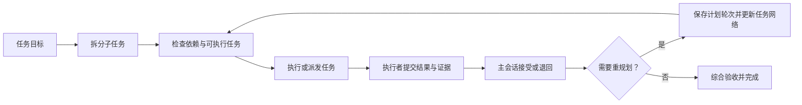

# Task Progress

简体中文 | [English](README.en.md)

当前版本：**0.2.0** · [更新记录](CHANGELOG.md)

**把 Codex 的多步骤工作变成清楚、可追踪、可复盘的任务网络。**

[](LICENSE)
[](https://carpe-horam.github.io/task-progress-codex/)

Task Progress 是一个 Codex 插件，包含交互式任务面板、MCP 服务、自动跟踪用的 `track-progress` skill，以及仅在用户明确要求时使用的 `cleanup-task-progress-history` skill。它帮助 Codex 把复杂目标拆成有依赖关系的任务，记录执行进度、结果与证据；需要查看时可在 Codex 中打开完整面板。

> [打开交互式宣传手册与功能演示](https://carpe-horam.github.io/task-progress-codex/) · [查看插件源码](https://github.com/carpe-horam/task-progress-codex/tree/main/plugins/task-progress)

## 效果图与动态演示

[](https://carpe-horam.github.io/task-progress-codex/#demo)

## 能做什么

| 能力 | 说明 |
| --- | --- |
| **开工前先规划** | 会话启动和每条新指令都会提示先判断粒度；多阶段工作可一次提交 HTN 任务树，未规划的空 root 会被服务端拒绝开工。 |
| **表达依赖与并行** | 标记任务前置条件。依赖已满足的任务可执行，同一批互不依赖的任务可以并行推进。 |
| **分工与独立验收** | 复杂工作默认委派，支持串行交接；分别记录计划执行者、派发绑定、子智能体提交与主会话复核，待复核结果不放行依赖。 |
| **独立请求排队与并行** | 中途收到无关任务时，由主会话判断排队或交给子智能体；独立实例不覆盖当前主任务，完成后继续检查原任务与队列。 |
| **压缩恢复与计划调整** | 保存目标、原文、约束、验收和恢复位置；主会话可补充或重规划，保留变更理由与既有证据。 |
| **按会话隔离与保存历史** | 每个 Codex 会话有独立进度；同一会话开始新任务后，旧任务归档到历史。重规划轮次和重试记录也会保留。 |
| **记录执行者与模型** | 展示主会话或子智能体，以及可获取的模型和思考强度；标注调用方填报与 Codex 核验状态，未知时不猜测。 |
| **查看结果与耗时** | 汇总任务状态、进度、持续时间、结果摘要与验收证据；详情默认收起，按需展开。 |
| **自动刷新** | 任务面板每 5 秒刷新一次，也可手动刷新。 |
| **导出执行记录** | 一键同时导出 Excel 工作簿和可视化 HTML，保存到本机 `Downloads/Task Progress Exports`。 |
| **适配不同客户端** | 支持 MCP Apps 的客户端显示交互式卡片；不支持卡片的客户端会收到可读的纯文本进度摘要。 |

## 工作方式

Task Progress 默认用 HTN（分层任务网络）表达多步骤工作：父任务可以继续拆分，子任务通过依赖关系连接。没有依赖关系的 ready 任务可以并行；有前置条件的任务会等待。Codex hooks 提供非阻断启动提醒；服务端会阻止未规划的空 root 开始执行。简单问答无需任务树，单步任务需记录 `atomic_reason`。

主会话负责规划和决策，Task Progress 持久保存任务细节并引导下一步。当前目标的补充沿用当前实例，简短问答答完后继续原工作；独立请求用 `route_request` 排队或建立并行实例。主任务如实收尾后用 `activate_request` 激活队首，不会因一个插入任务结束而把整会话标成完成。使用 `update_task_context` 保存恢复信息；详见 [请求分流与恢复](plugins/task-progress/skills/track-progress/references/request-routing.md)。

主进度显示按当前协议验收完成的已解决叶任务，待验收和执行结束分别展示。叶任务达到 100% 后仍需根任务综合验收；旧记录缺少验收信息时保持未知。插件不自动启动工作或唤醒闲置聊天。当前 HTML/XLSX 导出仍以所选任务的执行历史为范围，独立请求队列与恢复上下文通过 API 持久读取。

并行任务与主任务在同一个任务网络中显示为同级 root，按登记顺序接在主任务后，各自展开子任务与验收记录。它们仍是隔离实例，同级展示不建立额外父子依赖。未启动请求留在队列区，顶部百分比只统计主任务。



复杂分析、实现、多文件改动、专门验证和评审默认委派给子智能体，即使只能串行执行。依赖链可整体交给同一 agent；共享文件明确归属并串行交接。主会话负责规划、派发、协调、跨任务决策及验收；短小操作或确实不可交接的工作可自执行，并记录具体 `self_execution_reason`（显式原子 root 除外）。

计划执行者保存在 `planned_assignment`，启动不得静默换角色；pending 叶任务通过 `reassign_task` 记录主会话的变更理由。实际派发按 **启动 attempt → 创建子智能体 → `bind_task_agent` 绑定真实返回 ID** 进行。子智能体用 `update_task` 提交结果后显示 `awaiting_review`，主会话再用 `review_task` 接受或退回；待复核结果不会放行任何依赖。接受 open 结果仍是 open，父/root 只有直接子项全部 resolved 且无待复核项时才能综合验收为 resolved，并须记录主会话摘要和证据。

插件保存计划、派发、提交及复核记录并校验状态转换，不会自动创建子智能体。角色、agent ID 和 reviewer 都是调用方声明；HTTP 凭据不认证具体主/子会话身份，instance/attempt ID 也不是权限凭证。插件不能拦截其他工具中的实际工作。旧记录中没有的身份或验收信息保持未记录。详见 [职责协议](docs/responsibility-protocol.md) 与 [完整执行流程](plugins/task-progress/skills/track-progress/SKILL.md)。

长任务也更容易检查：单个任务执行超过 10 分钟后，进度工具会在下一次读取或更新时返回拆分复核提醒，要求 Codex 拆出可独立阶段，或记录不拆分的原因；不会为了拆分而中断正在运行的 Dagu、CI 或命令。

## 安装

### 从 GitHub Marketplace 安装

在终端添加此 Marketplace：

```sh
codex plugin marketplace add carpe-horam/task-progress-codex
codex plugin add task-progress@task-progress-codex
python3 "${CODEX_HOME:-$HOME/.codex}/plugins/cache/task-progress-codex/task-progress/0.2.0/service_manager.py" install
```

也可以在 Codex 桌面端打开 **Plugins Directory**，找到 **Task Progress** 并安装，然后执行上面的 `service_manager.py install`。0.2.0 起由一个用户级后台服务接收所有会话的连接；插件安装本身不会启动该后台服务。首次安装后重启 Codex，让插件服务和界面加载完成。

### 从本地克隆安装

```sh
git clone https://github.com/carpe-horam/task-progress-codex.git
codex plugin marketplace add ./task-progress-codex
python3 ./task-progress-codex/plugins/task-progress/service_manager.py install
codex plugin add task-progress@task-progress-codex
```

安装完成后重启 Codex。使用稳定安装的 Python 3 运行安装器；后台服务会记住该解释器的绝对路径。

### 更新插件

从 GitHub Marketplace 安装的插件，先刷新 Marketplace 快照：

```sh
codex plugin marketplace upgrade task-progress-codex
```

从本地克隆安装的插件，先在仓库目录拉取新版本：

```sh
cd task-progress-codex
git pull --ff-only origin main
```

更新来源后，重新安装插件，并从新安装目录运行 `service_manager.py install`（本地克隆可直接运行仓库中的安装器），最后重启 Codex。安装器会复用相同版本，或切换到新的运行目录；新服务健康检查失败时恢复旧安装。更新 Marketplace 快照只刷新可用插件来源，不会自动更新已安装插件和后台服务。

### 全局后台服务（macOS）

所有本机 Codex 会话直接连接 `http://127.0.0.1:53421/mcp`，共享 **一个 Python 服务进程**。会话连接和 UI 标签页仍是独立的，任务按 `session_id` 隔离；共享进程不意味着将所有请求串行执行。服务由用户 LaunchAgent `io.task-progress.mcp` 托管，登录后自动启动、异常退出后自动恢复。不会为每个会话额外启动 Python 代理。

安装器将运行文件复制到 `~/Library/Application Support/Task Progress/releases/`，插件缓存更新不会删除正在使用的运行文件。凭据位于 `~/.cache/task-progress/service/http-headers.json`，目录权限为 0700、文件权限为 0600。Codex 通过 `http_headers_helper` 短暂读取凭据；服务只监听本机环回地址，校验 Host 和 Bearer 凭据并拒绝浏览器跨域请求。

从本地仓库管理服务：

```sh
python3 plugins/task-progress/service_manager.py status --json
python3 plugins/task-progress/service_manager.py install   # 安装、更新或重新启动已停止的服务
python3 plugins/task-progress/service_manager.py stop      # 停止当前服务；影响所有使用它的会话
python3 plugins/task-progress/service_manager.py uninstall # 移除 LaunchAgent，保留任务、凭据和运行版本
```

从旧版 stdio 升级时，已经打开的会话可能继续持有旧进程，需重启 Codex 才能全部释放并切换；安装器不会强制终止这些会话。端口被非本插件服务占用时安装会报错，不会停止未知进程。服务日志在 `~/.cache/task-progress/service/service.{stdout,stderr}.log`。

自动后台管理目前支持 macOS。Linux 可先运行 `service_manager.py prepare`，再运行 `shared_service.py`，并自行配置用户服务；Windows 的后台管理与客户端凭据助手尚未验证。

## 开始使用

安装并启用插件后，会话启动和每条新指令会收到先规划再开始实质工作的提醒。若 Codex 审核并信任插件 hooks，提醒由宿主生命周期 hook 提供；多阶段任务还可在同一次 `init_task_network` 调用中提交粗计划。服务端拒绝未规划的空 root 开工。例如：

> 请梳理这个问题，按依赖拆分实现和验证步骤，并持续更新任务进度。

你也可以明确要求 Codex 使用 Task Progress。首次展示由主会话调用一次 `render_progress`，完整进度默认显示在会话内；普通任务更新只更新数据，不会重复弹出面板。用户将面板切换到 fullscreen 标签页后，会话内卡片暂时隐藏；关闭标签页后，会话内卡片恢复。旧来源的卡片会折叠，避免展示过期数据。当前公开的 MCP Apps 上下文未定义历史/归档会话状态，因此插件不能可靠判断并主动隐藏已保存在历史会话中的卡片。主会话面板会显示当前任务网络、执行状态、完成比例、任务摘要和历史计划。点击“刷新”可立即同步状态；点击“导出”可将当前任务记录保存为 Excel 与 HTML 文件。在主会话任务树中执行的子智能体只更新派发节点，不另开一份主会话面板。

默认规则：

- 多步骤任务使用 HTN 任务网络；线性步骤模式仅用于用户明确要求线性流程或恢复旧版任务。
- 多阶段新任务先提交至少两个有独立结果边界的粗任务；单步任务要记录具体 `atomic_reason`。未规划的空 root 不会进入 ready 列表或开始执行。
- 同一会话复用 session ID；同一目标的下一阶段继续当前任务或重规划。开始新目标时归档旧任务，尚未完成的旧任务须说明切换原因，运行中或待复核任务不能直接归档。
- 同一任务需要调整方案时，使用重规划轮次；重试会保留新的执行尝试记录。
- 重试会使依赖旧结果的下游及相关验收失效，必须重新执行或验收；卡片可展开查看保留的执行记录。
- 叶任务和顺序步骤必须先启动再标记完成；清空会话后，新任务的写入必须携带 `task_instance_id`，避免迟到请求污染新任务。
- 导出会标明旧执行记录是否已失效，并区分分组验收与取消/失败收尾。
- 自动刷新保留键盘焦点、文本选择和阅读位置，显示同步失败及恢复状态；卡片适配窄窗口和宿主明暗主题。
- 对不确定的模型或思考强度不猜测；未知值会显示为未记录。调用方填写的配置会标注采集时间，并明确显示“未经 Codex 宿主核验”。

## 数据与运行要求

- MCP 服务使用本机认证 HTTP，由同一操作系统用户的会话共享。当前任务保存在 `~/.cache/task-progress/sessions`；旧 `progress-v3.sqlite3` 中的记录作为独立只读历史摘录展示，不覆盖当前状态，不需要迁移，也不会随 GitHub 仓库上传。
- 普通读取只返回当前任务和历史计数；展开历史或导出时按需读取历史正文。面板与报告分别显示执行结束、待复核和已解决，执行结束 100% 不代表交付已验收。
- 需要 Python 3 和支持 Streamable HTTP、`http_headers_helper` 的 Codex 客户端；自动安装后台服务目前面向 macOS。`server.py` 保留 stdio 入口供兼容与隔离测试使用，默认插件连接不再启动它。
- 导出的 `.xlsx` 与 `.html` 文件写入当前用户的 `~/Downloads/Task Progress Exports`。
- Task Progress 记录与展示工作状态；Codex 的实际模型运行仍由用户自己的 Codex 账号和服务连接提供。
- 清除任务会删除当前进度、任务历史和视图登记；只保留不含任务内容的顺序计数器，防止迟到响应恢复已清除内容或替换新任务。

## 开发验证

后端回归使用 Python 标准库：`python3 -m unittest discover -s tests -v`。浏览器回归运行真实前端、隔离服务端与模拟 MCP Apps 宿主，需已有 Playwright 和 Chrome：`node tests/test_app.cjs`。详见 [测试说明](tests/README.md)。

## 项目结构

```text
.
├── .agents/plugins/marketplace.json    # Codex Marketplace 清单
├── docs/index.html                     # GitHub Pages 交互式宣传手册
└── plugins/task-progress/
    ├── .codex-plugin/plugin.json       # 插件清单
    ├── .mcp.json                       # 本机 MCP 服务配置
    ├── app.html                        # 交互式任务进度界面
    ├── server.py                       # MCP 服务与本地进度存储
    ├── shared_service.py               # 全局认证 HTTP 服务
    ├── service_manager.py              # 用户后台服务安装与管理
    ├── skills/track-progress/          # 自动规划与跟踪规则
    └── skills/cleanup-task-progress-history/  # 用户明确要求时清理已归档会话数据
```

## 常见问题

**插件已添加，但 Codex 里没有显示？** 先重载或重启 Codex，再从 **Plugins Directory** 安装插件。添加 Marketplace 只登记来源，不会自动安装其中的插件。

**为什么没有交互卡片？** 卡片依赖客户端对 MCP Apps 的支持。客户端不支持时，Task Progress 仍会返回纯文本进度摘要。

**插件会替我创建或调度子智能体吗？** 不会。插件表示任务层级、依赖和派发记录；实际创建与协调子智能体由 Codex 主会话完成。

**我的任务进度会上传到仓库吗？** 不会。仓库发布的是插件代码和宣传手册；运行时进度保存在本机用户缓存中。只有你明确导出或自行分享导出文件时，记录才会离开本机。

## 相关链接

- [Task Progress 交互式宣传手册](https://carpe-horam.github.io/task-progress-codex/)
- [GitHub 仓库与问题反馈](https://github.com/carpe-horam/task-progress-codex)
- [Task Progress 插件源码](https://github.com/carpe-horam/task-progress-codex/tree/main/plugins/task-progress)

## 许可证

本项目以 MIT License 发布，详见 [LICENSE](LICENSE)。
