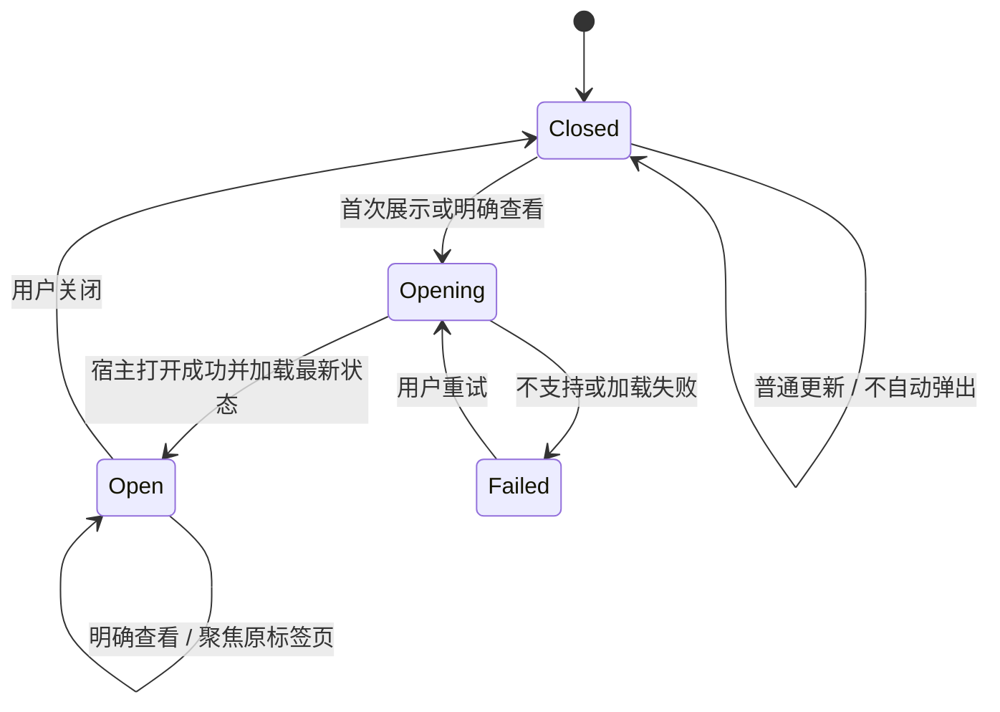

# Task Progress：会话内默认展示与 fullscreen 标签页互斥设计开发文档

- 日期：2026-10-26。
- 状态：2026-10-27 用户调整交互目标；以下“当前交互目标”优先于早期右侧标签页默认方案。真实 Codex 会话验收待执行。
- 设计研究最初基于：`codex/release-0.1.1`，`ac0a00ef5204cdd99390febd0353733eedb71f26`。实现分支：`codex/task-progress-main-session-tab`，从远端 `main` 的 `d6ea0024d9c76fe618e6e0d9770603924330c7e3`（Release Task Progress 0.1.1）起步。
- 宿主基线：Codex `26.1021.31345`，构建 `21828`；本机应用目录为 `/Applications/ChatGPT.app`，Bundle ID 为 `com.openai.codex`。

## 1. 当前交互目标（2026-10-27 更新）

完整进度默认显示在会话内。若同一会话存在打开的 Task Progress fullscreen 标签页，会话内卡片隐藏；fullscreen 视图关闭后，会话内卡片恢复。旧任务来源仍折叠，避免展示过期数据。插件按 `session_id` 隔离任务数据。

当前公开的 MCP Apps 上下文未定义历史/归档会话标志，因此插件无法可靠判断并主动隐藏已经保存在历史会话记录中的卡片。若 Codex 后续暴露该宿主状态，应再增加历史会话抑制；不能仅靠插件 `session_id` 推断会话是否历史。

本节覆盖并替代本文件中早期“右侧标签页默认打开、会话内只显示紧凑入口”的展示默认值。后续实现与验收按本节执行。

## 2. 目标与范围

本方案调整展示方式和视图生命周期，保留现有任务网络、步骤、历史任务、证据与导出能力。主会话继续管理总任务，子智能体按既有协议汇报，不能因子智能体更新而自动弹出另一份主会话面板。

本文是后续开发与验收依据，不代表功能已经交付。当前编写文档不包含代码修复、安装、提交、推送或发布。

## 3. 早期产品行为约定（已由上方新目标覆盖）

| 场景 | 目标行为 |
| --- | --- |
| 本次任务首次展示进度 | 打开并聚焦右侧 Task Progress 标签页，展开完整内容 |
| 用户点击“打开任务进度” | 有标签页则聚焦原页；已关闭则重新打开 |
| 用户让 agent“打开任务进度” | 调用明确的展示入口，执行同样的打开或聚焦行为 |
| 连续点击、重复展示调用 | 同一主会话只保留一个标签页 |
| agent 更新步骤、节点或证据 | 更新数据；已有标签页显示最新内容，不因每次更新抢焦点 |
| 标签页已被用户关闭 | 后台轮询和普通更新不重新弹出；明确查看时必须能够重开 |
| 会话内工具调用记录 | 保留紧凑状态或原生打开入口，默认不展开完整任务面板 |
| 历史卡片被再次点击 | 打开本会话的最新进度；历史任务通过面板内历史入口查看 |
| 同一会话产生下一项任务 | 已有标签页继续复用并显示新任务，不随任务实例变化另开一页 |
| 切换到其他会话 | 各会话独立，不把其他会话的任务数据放进当前面板 |
| 重新进入历史会话 | 不因历史记录挂载而批量开页或抢焦点；显式查看后恢复最新进度 |
| 宿主不支持标签页或打开失败 | 会话内保持紧凑入口，给出可重试的说明，不自动展开大面板 |

“首次展示”指任务入口明确发起的展示动作，不等于任意历史记录的首次挂载。用户关闭页面后，后续任务数据变化不应被当成新的打开授权。

关闭页面只结束展示，不清除任务数据。重开后从服务器获取最新状态，并提供完整任务、历史记录和导出功能。不得把关闭、切换会话或组件销毁映射为 `clear_progress`。

## 4. 研究结论与证据等级

### 4.1 已确认的当前宿主实现

以下结论来自本机应用包的静态检查，范围限于上面的宿主版本。

| 能力 | 观察到的实现 | 结论边界 |
| --- | --- | --- |
| 默认显示模式 | 资源解析器读取 `openai/ui.availableDisplayModes` 与 `preferredDisplayMode` | 可以表达标签页优先，但需要在实际插件链路中验证 |
| 全屏与标签页映射 | `fullscreen` 对应 MCP App 侧边标签页；原生按钮文案为 “Open app in tab” | 这里的全屏是宿主显示模式，不是打开系统浏览器 |
| 共享视图 | 匹配 `openai/widgetSessionId`、host、conversation、server、资源 URI 和资源身份后复用会话实例 | 不仅比较一个字符串，还受注册时机和资源身份限制 |
| 新结果替换来源 | 复用实例可以把数据来源切换到较新的工具调用 | 可支持持续更新，但通知顺序和陈旧结果需要验证 |
| 原有标签页聚焦 | 宿主打开逻辑识别已有标签页并切换到它 | 插件没有因此获得任意枚举、聚焦宿主标签页的通用 API |
| 会话内紧凑展示 | 全屏或被复用的旧来源在宿主中呈现为 launcher，而不是完整 inline 内容 | 外层工具调用分组的折叠状态仍由 Codex 决定 |

静态证据位置：`/Applications/ChatGPT.app/Contents/Resources/app.asar` 内的以下资源。

- `webview/assets/resource-52711a0ee5f2.js`：显示模式及资源元数据解析。
- `webview/assets/app-initial-feb30b196d11.js`：视图注册、复用、来源切换和标签页身份；本次对应函数为 `ANa`、`YNa`、`MNa`、`PNa`、`VNa`、`dNa`。
- `webview/assets/widget-8367811f39d7.js`：初始化、显示模式协商、标签页挂载。
- `webview/assets/open-button-23d11673f594.js`：原生打开标签页入口。
- `webview/assets/subagent-activity-chip-group-a0fc2223efe0.js`：工具结果与视图注册链路。

这些文件名和压缩函数名只用于定位本次证据，不能成为插件运行时依赖。开发不得调用或修改宿主内部函数。

### 4.2 官方协议与当前版本扩展

官方文档说明，可以在资源内容的 `_meta["openai/ui"].availableDisplayModes` 中提前声明支持的模式，并在 MCP Apps 初始化时再次声明。仅在 iframe 挂载后请求全屏，不能替代加载前的声明。[官方显示模式文档](https://developers.openai.com/plugins/reference#declare-display-modes-before-the-ui-loads)

官方把 `openai/widgetSessionId` 描述为宿主提供的、用于标识当前已挂载组件实例的 ID；插件不得自行设置或伪造它。插件自行在工具结果中提供稳定标识以参与 Codex 复用，缺少公开协议依据，不再作为实现候选。`preferredDisplayMode` 的使用也应作为当前宿主兼容逻辑处理。[官方工具结果文档](https://developers.openai.com/plugins/reference#tool-results)

官方还介绍了 conversation/thread 侧边入口，可作为固定入口的后续研究方向；本次没有验证该入口在当前本地插件中的完整行为，不把它作为已具备的重开能力。[官方扩展说明](https://developers.openai.com/plugins/build/extensions)

历史研究曾认为自动开页与复用不可靠。本次发现了当前版本中的具体实现路径，但不能据此省略真实会话测试，也不推断这些机制从哪个版本开始提供。

### 4.3 必须先验证的时序风险

现有工具描述提前暴露 UI 资源。宿主可能在工具结果到达前注册视图，此时没有可用于复用的 `widgetSessionId`，于是创建新实例。结果返回后，即使附带相同标识，已有实例也不一定重新参与合并。

因此，“所有结果加同一个标识”不足以保证单标签页。需要验证让资源地址与身份标识在首次注册时同时可用的方案，并覆盖两个结果交错到达的情况。

## 5. 当前插件差距

| 位置 | 当前行为 | 开发需要 |
| --- | --- | --- |
| `server.py::_tool_meta` | 仅关联固定 UI 资源；多个读写工具都关联 UI | 区分数据更新与明确展示，控制何时触发视图创建 |
| `server.py::resources/read` | 只声明 `ui.prefersBorder` | 增加显示模式元数据，验证宿主读取结果 |
| `server.py::render_progress` | 基本复用 `get_progress` 返回值 | 作为候选的明确展示入口，验证打开、复用与重开 |
| `app.html::ui/initialize` | `appCapabilities` 为空 | 声明实际支持的显示模式，并读取宿主协商结果 |
| `app.html::collapseSupersededView` | 标记 `superseded`，隐藏内容并停止轮询 | 不得用该永久失效状态表示普通折叠 |
| `app.html::host-context-changed` | 切换模式但不恢复已有 `superseded` 状态 | 分离紧凑展示、来源失效和实例销毁；保证打开标签页后内容可见 |
| `register_ui_view/check_ui_view` | 协调会话内卡片新旧 | 保留其兼容职责，不把它们当作宿主标签页登记表 |

对应源码：[server.py](/Users/machengling/.codex/worktrees/ef11/task-process/plugins/task-progress/server.py)、[app.html](/Users/machengling/.codex/worktrees/ef11/task-process/plugins/task-progress/app.html)。

## 6. 实现方案

### 6.1 职责划分

| 层级 | 负责 | 不应承担 |
| --- | --- | --- |
| Codex 宿主 | 标签页创建、关闭、聚焦、同一视图实例的挂载和复用 | 插件不能直接控制的外层界面状态 |
| MCP 服务端 | 会话任务数据、稳定身份候选、资源和结果元数据 | 用文件中的 `tab_open=true` 冒充真实标签页状态 |
| 前端组件 | 完整面板、紧凑内容、刷新、错误恢复、显示模式协商 | 假设 iframe 能枚举宿主标签页或操作父页面 DOM |
| agent / skill | 区分首次展示、明确查看、普通更新；保持会话归属 | 每次更新都重新调用展示入口 |

不使用 `window.open`、系统浏览器或额外本地网页来替代用户要求的 Codex 标签页。

### 6.2 当前最小宿主验证

使用隔离的测试会话和测试安装验证下面五件事：

1. 首次展示的完整面板默认以内嵌会话内容出现。
2. fullscreen Task Progress 标签页打开时，同会话内嵌卡片隐藏。
3. fullscreen 标签页关闭后，内嵌卡片恢复并显示最新任务数据。
4. 普通数据更新与后台轮询不重新打开已关闭的标签页，也不抢焦点。
5. 较旧任务来源折叠；不同会话的任务与视图互不影响。

历史/归档会话抑制依赖宿主提供明确的历史状态。当前公开插件接口没有该状态，因此此项应记录为宿主能力限制，不得用模拟宿主通过替代真实 Codex 验收。

### 6.3 身份设计

必须区分四种标识：

| 标识 | 生命周期与用途 |
| --- | --- |
| `session_id` | 已有业务会话归属；数据查询与隔离的依据 |
| `task_instance_id` | 单次任务实例；防止旧任务更新写入新任务 |
| 宿主组件身份 | 由 Codex 宿主通过 `openai/widgetSessionId` 管理；插件不能写入或伪造 |
| `viewId` | 每次组件挂载生成，用于组件生命周期和旧卡片协调 |

业务 `session_id` 只用于任务数据隔离，不是宿主组件身份。当前没有公开的插件可写入标签页复用键；只能通过真实 Codex 验证宿主是否按会话与资源身份复用。不得把插件生成的字段冒充 `openai/widgetSessionId`。

该标识不是鉴权凭据，不替代会话校验。主会话与子智能体继续使用既有归属规则；不能为了复用页面而改写数据所有权。宿主实际分配的 session/tab ID 由宿主管理，插件不得自行伪造这两类内部 ID。

### 5.4 显示模式声明

候选资源元数据如下，仅作为待验证设计示例：

```json
{
  "ui": { "prefersBorder": true },
  "openai/ui": {
    "availableDisplayModes": ["inline", "fullscreen"],
    "preferredDisplayMode": "fullscreen"
  }
}
```

前端初始化同样声明支持的显示模式。这里的 `inline` 只承担紧凑入口和错误提示；完整内容默认展示在 `fullscreen` 对应的标签页。

不能只依赖初始化之后的 `ui/request-display-mode`：内联组件可能尚未挂载，而且对已经处于全屏模式的重复请求未必触发聚焦。必须读取实际协商结果；不能把“请求已发送”当作“页面已打开”。

### 5.5 数据更新与展示入口分离

优先评估复用现有 `render_progress(session_id)` 作为唯一明确展示入口，避免再增加含义重复的工具。

- `init_progress` / `init_task_network`：建立数据，任务入口在需要首次展示时调用 `render_progress`。
- `update_task` / `update_step` / `decompose_task` 等：更新任务，返回业务状态，不因普通更新创建新的 UI。
- `get_progress`：供面板刷新；轮询不携带会引发新面板创建的副作用。
- `render_progress`：唯一在工具描述符中声明 UI resource 的明确展示工具；返回当前会话最新数据。
- `clear_progress`：维持原有使用边界，不能由标签页关闭触发。

工具 URI 应依照官方 MCP Apps 约定绑定在工具描述符中，才能让宿主把对应工具结果转交给组件。只给结果附 UI resource URI 会创建页面但未把结果数据送入组件；当前真实探针观察到空面板。修正后的候选仅在明确的 `render_progress` 工具描述符上声明资源，初始化和普通更新仍不声明 UI。真实 Codex 中重复调用会创建独立标签页，当前宿主没有按业务会话和资源身份自动复用。不得由插件补写 `openai/widgetSessionId`。截至本次实现，没有找到公开宿主 API 可聚焦或复用已有标签页，故“重复工具调用只保留一个页面并聚焦”不能由插件保证。

不要在所有普通结果上机械附加 UI 元数据。即使复用成功，新工具结果的注册也可能触发宿主聚焦。

在宿主提供稳定复用/聚焦接口前，agent 规则只在首次展示时调用一次 `render_progress`；普通更新复用当前面板数据。后续查看通过同一会话紧凑入口中的按钮请求切换至 fullscreen。该交互的真实关闭后重开链路仍未验收。仅通过 skill 约定“只调用一次”是避免重复开页的产品降级，不满足严格单页复用、已有页聚焦和 agent 调用重开要求。

### 5.6 折叠、失效与刷新

前端应分别表达以下概念，而不是复用一个 `superseded` 布尔值：

- 展示方式：紧凑入口 / 完整面板。
- 数据来源：当前来源 / 已被较新结果替代。
- 组件生命周期：存活 / 已销毁。

紧凑显示不代表数据失效；切到完整面板时应能恢复内容并获取最新数据。旧来源不再自行刷新，但其宿主打开入口应能够指向共享的当前面板。若宿主不能保留旧来源的入口，至少保证当前会话有一个可用的重开入口，并把差异写入验收记录。

已打开且可见的标签页保留自动刷新、手动刷新、最近检查时间和失败提示。任务完成后仍需能够发现同一会话的新任务。隐藏或销毁的组件停止无用轮询；重新可见或重开时立即请求最新状态。不得为了探测标签页是否关闭而持续新建 iframe。

服务器中的任务状态是数据真相；宿主的标签页状态是展示真相。插件收不到可靠关闭事件时，应依赖宿主生命周期和明确展示动作，而不是推测用户是否关页。

## 6. 生命周期与交互状态

下面是产品状态模型，不要求插件维护一份完整的宿主标签页状态镜像。



| 操作 | 焦点策略 | 数据策略 |
| --- | --- | --- |
| 首次明确展示 | 聚焦新标签页 | 读取最新进度 |
| 重复明确展示 | 聚焦原标签页 | 刷新最新进度 |
| 已关闭后重开 | 聚焦重新创建的标签页 | 读取当前任务与历史，不恢复过时快照 |
| 后台更新 | 保持用户当前焦点 | 下一次可见刷新反映变化 |
| 历史记录挂载 | 不抢焦点 | 保留入口，按需查询 |
| 打开失败 | 保留可操作的紧凑入口 | 不清空已有任务数据 |

宿主创建/聚焦动作不能由前端自己绘制的“已打开”文字代替。验收要观察实际标签页数量、当前激活页和面板内容。

## 7. 开发拆分与交付顺序

| 阶段 | 工作 | 完成条件 |
| --- | --- | --- |
| A：宿主能力验证 | 验证显示模式、身份复用、首次注册时机、聚焦和重开 | 五项最小宿主验证有可复现证据；明确哪些扩展可用 |
| B：服务端协议调整 | 分离数据与展示元数据、定义稳定身份、完善错误结果 | 普通更新不触发展示；不同业务会话身份隔离 |
| C：前端状态调整 | 紧凑视图与完整视图分离，处理失效来源和可见性恢复 | 展开后不残留隐藏状态；重开立即显示最新进度 |
| D：agent 使用规则 | 更新首次展示、明确查看、普通更新、子智能体边界 | agent 能按意图调用展示入口，普通更新不会反复开页 |
| E：回归与兼容 | 后端、模拟宿主和真实 Codex 分层验收 | 本文验收矩阵通过，限制如实记录 |

预期涉及文件：

- [server.py](/Users/machengling/.codex/worktrees/ef11/task-process/plugins/task-progress/server.py)：资源与工具元数据、展示结果组装。
- [app.html](/Users/machengling/.codex/worktrees/ef11/task-process/plugins/task-progress/app.html)：显示模式声明、视图状态、刷新与恢复。
- [track-progress/SKILL.md](/Users/machengling/.codex/worktrees/ef11/task-process/plugins/task-progress/skills/track-progress/SKILL.md)：agent 展示与更新规则。
- [test_server.py](/Users/machengling/.codex/worktrees/ef11/task-process/tests/test_server.py)：身份、元数据和会话隔离。
- [test_app.cjs](/Users/machengling/.codex/worktrees/ef11/task-process/tests/test_app.cjs)、[test_interaction.cjs](/Users/machengling/.codex/worktrees/ef11/task-process/tests/test_interaction.cjs)：模式切换、失效恢复和交互回归。

在阶段 A 通过前，不把依赖宿主私有行为的候选方案推广为所有版本的默认行为。不能声称存在尚未发现的通用标签页 API。若核心能力不成立，应收敛兼容范围或调整方案，并说明未满足的验收项。

## 8. 验收矩阵

| 编号 | 场景与操作 | 必须观察到的结果 | 验证层 |
| --- | --- | --- | --- |
| T01 | 新会话首次展示 | 一个进度标签页被打开并聚焦；会话内无完整大面板 | 真实 Codex |
| T02 | 连续调用展示入口 5 次 | 始终只有一个进度标签页，内容是最新状态 | 真实 Codex |
| T03 | 切到其他标签页，再明确查看进度 | 聚焦原进度标签页，不新增第二个 | 真实 Codex |
| T04 | 关闭标签页，再点击会话入口 | 重新打开一个完整面板，任务数据仍在 | 真实 Codex |
| T05 | 关闭后让 agent“打开任务进度” | 与点击入口一致，可重开、可操作 | 真实 Codex |
| T06 | 关闭后连续更新节点 | 标签页保持关闭；之后重开显示更新结果 | 真实 Codex |
| T07 | 两次展示请求并发、结果交错 | 不产生两个标签页，不被旧结果覆盖 | 模拟宿主 + 真实 Codex |
| T08 | UI 资源先返回、结果后返回；再反转顺序 | 明确排除提前注册导致的重复实例 | 模拟宿主 + 真实 Codex |
| T09 | 从旧卡片打开进度 | 完整面板可见，可刷新，显示当前会话最新数据 | 模拟宿主 + 真实 Codex |
| T10 | 当前任务完成，同会话创建新任务 | 复用标签页并发现新任务；历史仍可查看 | 后端 + 前端 + 真实 Codex |
| T11 | 两个会话分别展示进度 | 各自一个页面，数据和入口不串会话 | 后端 + 真实 Codex |
| T12 | 子智能体更新主任务关联节点 | 不额外创建另一份主面板，归属规则不变化 | 后端 + 真实 Codex |
| T13 | 离开再进入会话，滚动加载历史 | 不批量开页、不因历史挂载抢焦点；入口可重开 | 真实 Codex |
| T14 | Codex 重启或插件重载后明确查看 | 不依赖旧 iframe 的内存；可从持久任务数据恢复 | 真实 Codex |
| T15 | 标签页隐藏后恢复可见 | 刷新最新数据，自动刷新状态与手动按钮正常 | 前端 + 真实 Codex |
| T16 | 模拟不支持 fullscreen 或加载失败 | 紧凑提示可重试，任务数据完整，不假报打开成功 | 模拟宿主 |
| T17 | 重新打开后使用历史与导出 | 原有功能可用，导出内容与当前选择一致 | 最小相关回归 + 真实 Codex |

后端测试验证数据与协议，浏览器模拟宿主验证组件行为；两者都不能证明真实 Codex 的标签页数量、聚焦或关闭后重开。真实宿主记录需注明源码 SHA、安装来源、Codex 版本和实际操作顺序，保留能同时看到会话与标签页的截图或录像。

测试执行遵循当前工作区的 `dagu-test-runner` 路由规范：命中白名单或预计超过 1 分钟的命令通过 Dagu；其余短命令默认本地运行。Dagu 不可用或不支持应走 Dagu 的命令时停止并说明。涉及共享资源的浏览器用例串行或隔离执行。只运行能覆盖本次风险的相关测试，不因编写本文启动产品测试或改动真实会话数据。

## 9. 兼容、失败与发布判断

- 兼容范围以实际通过验收的 Codex 版本为准。当前只确认了一个版本的静态实现，尚无最低版本结论。
- 初始化时读取宿主返回的模式与能力；对没有公开能力协商的去重扩展，以实际验证记录界定支持范围。
- 宿主忽略元数据、覆盖标识、拒绝切换模式时，保留紧凑入口和失败说明，不循环请求打开。
- “可手动打开多个页面”或“工具返回成功”均不满足单标签页要求；兼容降级不能记为核心验收通过。
- 回退展示行为时保留已有任务数据，不通过清空会话或删除历史解决 UI 问题。

严格单标签页能力的发布完成条件仍是：默认标签页、重复调用复用、已有页聚焦、关闭后重开、普通更新不抢焦点、会话隔离六项均有真实宿主证据；普通组件回归通过；兼容限制和失败路径已记录。目前重复调用在真实宿主已观测为创建多个页，严格要求未完成。

## 10. 待决事项

1. 结果阶段提供 UI 资源地址是否能在 Codex 当前宿主打开组件，且避免提前创建实例。
2. 结果地址在并发和交错结果下是否仍能复用同一宿主组件，并避免旧结果覆盖新状态。
3. 明确展示动作能否在当前模式已经是 `fullscreen` 时仍可靠聚焦已有页。
4. 用户关闭标签页后，宿主保留哪些实例与入口状态；如何避免普通更新意外重开。
5. 旧来源被宿主压缩后是否仍有可用的打开入口；如无，当前会话的固定入口应如何提供。
6. 升级或重启后的资源身份变化是否会造成重复页，以及实际支持的宿主版本范围。

以上事项由阶段 A 的真实会话验证收敛。当前结论是存在候选路径，尚不能把严格单页复用与重开写成已实现能力。

## 11. 2026-10-27 实施跟进

- 已重新核对实现工作区：`codex/task-progress-main-session-tab`，HEAD `d6ea0024d9c76fe618e6e0d9770603924330c7e3`；目录中既有未跟踪 `docs/reviews` 文件均保留。
- 官方工具结果文档明确 `openai/widgetSessionId` 是宿主提供的当前挂载实例 ID，因此实现没有设置该字段。
- 直接从当前 Codex 会话调用 MCP 工具进行探针：初始化测试会话没有创建 UI 页；旧的结果阶段 resource 方案下连续两次 `render_progress` 后 MCP Apps 标签页清单增加两个同名页（2→3→4）。`codex plugin list` 确认插件源路径为本工作区 `plugins/task-progress`。该结果验证的是修复前的资源绑定方式；修复后的 T02 待复测。
- 新标签页的可访问性快照显示“当前会话暂无任务”，与同次工具结果中的测试任务数据不一致。根因是候选把 UI resource URI 放在工具结果而非工具描述符；已按官方协议把资源绑定移到仅 `render_progress` 的工具描述符，并通过 `codex plugin add` 重装，缓存文件已与工作区候选一致。但当前会话 `ALL_TOOLS` 仍暴露旧工具描述，说明连接未刷新；T01 数据转交和 T02 需刷新 Codex 插件连接后复验。
- `cua_repl` 可列出 MCP Apps 标签页并读取新页，但不能关闭/聚焦 Codex 外层页；T03 和 T04 无法实测。后台更新不产生 UI 资源的协议检查和隔离模拟回归通过，T06 仍需真实关闭页面后验证。
- 工作区候选和已重装缓存只在 `render_progress` 工具描述符绑定 UI resource，并提供紧凑入口按钮；agent 规则已调整为首次展示调用一次。活动 Codex 连接仍显示旧 descriptor，须刷新连接后才能复验 T01/T02；真实重开流程、焦点保持与会话隔离尚未验收。
