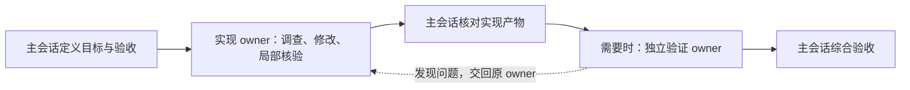

# Task Progress 智能体协作优化方案

日期：2026-11-06

状态：实施中。S0 方法、源码行为、测试前基线和记录模板已固定；负责人确认 FIX-1、INV-2、MOD-1 各做 A/B/C 一轮，共 9 轮校准。输入与 oracle 沿用不可变 selected-candidates v1；配置快照 v2 锁定 A/B/C 路线与各自 skill/server hash。9 个独立 clean worktree 和 blind prompt hash 已准备；两版本 stdio MCP 握手与工具列表读回通过。FIX-1-A 已运行并由独立 oracle 评分：395.116 秒，F1–F6 pass、F7 fail，整体质量门 fail；用量 3,722,401 input（含 3,606,528 cached）、19,099 output tokens，费用 unknown。其余 8 轮等待负责人确认是否接受无 token/费用上限或给出预算；不得据单轮得出总体效率结论。S1 接口及规则已实现；按当前 Codex/macOS 目标环境与矩阵条件验收，A1–A5 均通过（A2 当前 host 的 unsupported 条件分支为 not_applicable），当前源码后端 40 项责任/派发回归和浏览器面板/HTML/XLSX 12 场景通过。真实 Codex v0.2.20 已跑通 spawn→同一 owner follow-up→提交→主会话复核。A2 真实宿主样本覆盖显式 `none`（目标旧消息不可见）、显式 `all` 和省略参数（目标旧消息可见），证明当前 Codex 宿主支持本次使用的分支；因此“不支持分支”对当前宿主记 `not_applicable`。旧 v0.2.19 服务端无 capability 时拒绝 `fork_turns=all` 且无状态变化，另有 A5 回退证据。A3 同一 owner 的退回重试、旧提交拒绝和新 attempt 接受后的旧 review 拒绝已由真实宿主样本验证。A4 真实宿主样本已覆盖仍可寻址、无活动 turn 的 completed owner：`send_message` 后 agent 仍为 completed 且 Task Progress attempts 未变；同一 owner 的真实 `followup_task` 创建新 attempt 并完成提交/复核。当前 Codex 没有独立 idle 状态，此处将 completed/no-active-turn 作为 idle 等价样本；不推导 S3 hook 的因果关联。A5 的旧数据、旧客户端到新服务、UI/导出和 capability 缺失时的 v0.2.19 服务端回退均有回归/源码级证据，派发指南有能力门控协议测试；Codex 原生跨版本加载和 Windows 尚未验证。S2 后端契约、独立 checks、产物版本绑定与详情导出已实现；v0.2.21 merge SHA 上全套后端 328 项和面板/HTML/XLSX 浏览器 12 场景通过。S3 基础 hook 已有 guided observation；精确派发因果关联仍未证实，不能声称服务端自动绑定验收通过。

源码基点：`ef7f37f1a3502f17c1c69aec95b801250a82b23d`。实施前重新核对源码和宿主能力。

## 1. 目标与设计决定

目标是让主会话少处理重复交接与机械记账，同时保留任务结果可复核、依赖不提前放行和历史可恢复的能力。

采用以下决定：

1. 主会话负责用户目标、跨任务协调与最终交付；同一执行者持续负责一条紧密相关的工作链。
2. 工作阶段与执行者身份分别表达。调查、实现、局部验证可以在一个结果边界内完成；出现独立产物、独立执行者或独立验收要求时才拆节点。
3. 模型、推理强度与上下文策略如实记录；未知配置不阻止宿主本来支持的委派。
4. 对重要结果引入可选的结构化验收契约。记录核验了什么，不把填写 evidence 或 accepted 状态当作质量证明。
5. 自动化有明确关联的派发绑定与执行事实；任务是否解决仍由执行提交和独立验收决定。
6. 先采集小规模基线，再逐项验证收益。真实宿主验证随对应适配器推进。

这与 DeepSeek 最近的 Router/Worker 设计有交集。研究来源、实验边界及适配取舍见[研究笔记](2026-11-06-deepseek-super-agent-research.md)。本方案首先优化有限任务下的协作，不要求部署常驻跨渠道 Agent。

### 必须保留的约束

- `planned_assignment` 与实际 attempt 快照分离，运行中的快照不可覆盖。
- instance、epoch、task、attempt 身份精确匹配；重试生成新 attempt，迟到结果不得覆盖当前结果。
- submission 与 review 分离；pending review 不满足任何现有依赖策略。
- `review_task(accept)` 不把提交的 open 升级为 resolved；根任务仍需综合验收。
- 重试使相关后继及祖先验收失效；有运行中或待验收消费者时不能直接重试前驱。
- 阶段盘点、执行结果、依赖状态及接受收尾是不同事实。
- 角色和宿主配置的调用方声明保持未认证；hook 观察事实不升级为身份认证。
- 主会话叶任务串行；已有独立执行可继续并行。插件状态变化不代表已停止真实进程或 agent。

## 2. 修改分工规则

| 编号 | 当前入口 | 目标规则 | 可观察的验收条件 |
| --- | --- | --- | --- |
| R1 | `delegation.md`、`htn-planning.md` | 复杂执行仍优先委派；优先把同一问题的调查、修复和局部核验交给同一 owner。阶段节点不要求新建 agent | 示例可以用一个 worker 处理一个修复结果；拆成多个节点时，用 `followup_task` 复用真实 agent ID |
| R2 | `delegation.md`、`planning-and-lifecycle.md` | 主会话维护目标、独立结果、依赖与资源边界。worker 可自主安排范围内步骤并提交局部计划；新增独立结果或新执行者时请求主会话调整树 | 日志中不为每个命令建节点；worker 不改兄弟任务、不接受自己的提交、不扩大工作范围 |
| R3 | `htn-retry.md` | 退回优先交回原 owner；新 attempt 重新记录本轮明确配置，复用的是 agent/context，不复用旧 attempt 身份 | 一次退回后仍由原 agent 执行；旧 attempt 上报被拒；原 agent 不可用时记录交接理由和证据 |
| R4 | `delegation.md`、`htn-dispatch.md` | 独立探索默认新上下文；同一工作链默认复用原 worker；确需已有完整上下文且宿主支持时允许继承 | fresh、inherit、reuse 三种用法均有示例；实际参数与记录一致；不会把 follow-up 误记为新 spawn |
| R5 | `htn-review.md` | 普通任务由主会话核对产物；高风险或难以直接核验的结果设置独立验证任务，主会话负责最终取舍 | 验证者与实现者的声明 agent ID 不同；核验记录引用实际产物和当前输入 attempt；同模型不等于同执行者，也不保证错误独立 |
| R6 | `startup.md`、`query-and-display.md` | 完整派发文本保存在账本；用户更新只保留目标、owner、重要约束和决策。避免每次展示完整工具参数表 | 运行轨迹可恢复完整派发；普通用户更新无需重印长指令；不增加确认步骤 |
| R7 | `delegation.md` | 共享文件/环境先明确 owner；同文件写入串行或隔离。当前阶段采用指导规则和范围说明 | 多模块示例先约定接口；不得把订阅同一事件视为文件冲突已被解决 |

主会话直接处理短小工作仍允许，并简短记录原因。复杂工作采用自执行例外时说明真实限制；不把“串行”作为禁止委派的理由，也不把“复杂”解释为必须多开多个 worker。

### 推荐任务形态



单一修复可以是一个叶节点。需要独立验证时，用分组表达“交付结果”，子项为 implementation 与 verification。implementation 的验收范围是“实现产物及局部证据齐备”；整个交付分组的验收范围包含最终兼容性或业务正确性。

**不要让验证任务依赖仍处于 pending review 的实现提交。**现有 `depends_on` 连同 `finished` 策略都不会放行这种依赖。先对范围明确的 implementation 子项做阶段验收，再启动依赖它的 verification 子项，最终验收交付分组。

验证发现问题的完整顺序是：verification 提交 `finished/open` → 主会话 `review_task(accept)` 保留 open，或 `reject` 记录退回 → implementation 用 `retry=true` 开始新 attempt → 既有失效传播使旧 verification/祖先验收失效 → 主会话复核新 implementation → 原验证者以新 attempt 重做。pending review 必须先处理；不能把“验证已返回”当作可以重试前驱。真正 failed/cancelled 且无 submission 的验证按其实际终态处理。

## 3. 接口改动 A：允许真实的继承与未知配置

修改 `server.py` 的 `_normalize_assignment`、`_require_execution_metadata`、`_metadata_provenance`、`_assignment_schema`；所有共用 assignment 的规划、启动、重试和旧线性接口一起更新。

### 3.1 additive 字段与归一化

保留 `assignment.model`、`reasoning_effort`。新增可选字段：

| 字段 | 值 | 规则 |
| --- | --- | --- |
| `model_source` | `explicit` / `inherited` / `unknown` | 有非空 model 且省略 source 时为 explicit；两者都省略时为 unknown |
| `reasoning_effort_source` | 同上 | 与 model 独立判断；允许只明确其中一项 |
| `fork_turns` | `none` / `all`，可省略 | 只保存明确提供的值；省略保持未记录，不自动补 none |

`explicit` 必须有合法值；`inherited` 和 `unknown` 不携带具体值，避免把请求配置与实际运行配置混用。空串按未提供处理；不接受 `model="unknown"` 作为协议占位示例。宿主明确报告的实际模型属于另一条观察事实，不反向改写启动时的 assignment。

```json
{
  "execution_mode": "subagent",
  "tool_identifier": "collaboration.spawn_agent",
  "dispatch_text": "背景、范围、产物与验收要求……",
  "model_source": "inherited",
  "reasoning_effort_source": "unknown",
  "fork_turns": "all"
}
```

服务端检查描述是否自洽。宿主支持哪些配置，由实际派发工具决定；服务端接受记录不代表宿主支持或已执行。显式不支持的派发应失败并如实收尾。

`metadata_provenance` 继续由服务端生成，表示输入来源及未认证状态；其中原有 `model_source=mcp_tool_input` 等来源字段与新增 selection 字段含义不同，不互相替换。UI 要显示“继承配置，实际值未记录”，不能显示为某个确定模型。

### 3.2 兼容与发布顺序

- 旧调用明确传 model/effort 时行为相同；旧存储不改写。
- 兼容升级前已启动的 attempt：不可变 assignment 比较使用只读等价视图，将旧非空值对应到 explicit、旧缺失值对应到 unknown；不把新归一化时补出的字段直接与旧字典做差异比较。旧客户端重传相同 assignment 能继续和收尾；新客户端也不能借补填 source 改变旧执行事实。比较所用默认值不写回旧快照或 provenance。
- 历史自动补出的 `fork_turns=none` 继续显示为历史记录、未经核验，不补造新的来源。
- 新服务端允许未知配置后，再一起发布更新的技能、工具 schema 和示例；旧服务端期间技能保持旧流程。
- `get_progress(view="overview")` 的顶层返回可选 `protocol_capabilities`，例如 `assignment_sources_v1`、`fork_context_v1`。首次或恢复查询可获得，无额外握手工具；未返回能力时不发送新字段、不强迫模型猜值。
- 服务端升级后旧客户端继续使用显式配置；新客户端遇到旧服务端采取原有可行路径或报告限制，不伪造配置。

### 3.3 连续执行与 follow-up

复用 agent 使用现有 `followup_task` 和新 attempt；保留当前真实 agent 绑定。核对 `_begin_attempt` 中的 follow-up 白名单和 hook 分类：`send_message` 只表示投递消息，不能一概认为它会唤醒 idle agent 或开始新执行。只有宿主契约明确有执行效果的入口才可走立即绑定路径；普通补充消息不创建新的执行事实。

## 4. 接口改动 B：可选的任务验收契约

不要求每个任务填写新表单。对需要逐项核验的任务，在 `init_task_network.tasks[]`、`decompose_task.tasks[]` 增加可选的节点字段 `acceptance`；`init_task_network` 和 `rebuild_task_network` 增加可选 `root_acceptance`，同时覆盖分组 root 和以 atomic_reason 初始化的原子 root。

对尚未启动的节点，用现有 `revise_task_plan` 增加可选 acceptance 参数，以 epoch、revision 和 reason 记录修订。当前该工具排除 root，实施时增加仅修改 acceptance 的 root 分支；不因此开放 root 的移动、重新分组或依赖修改。root/分组只有自身和全部后代均未开始时可改契约。运行中/终态节点不得原位改写；需要改变已执行范围时按现有重规划方式处理。

能力标志增加 `acceptance_contract_v1`。新任务没有契约时旧客户端照常；已声明契约的任务由旧客户端验收、缺少 checks 时，返回稳定的 `acceptance_checks_required` 错误及应补 criterion IDs，不修改状态、不自动降级契约。旧客户端无法提交时改用支持的调用路径或显式重规划，不能静默接受。

```json
{
  "acceptance": {
    "version": 1,
    "criteria": [
      {"id": "reproduce", "text": "原始场景能够稳定复现并得到修复", "method": "command", "required": true},
      {"id": "compat", "text": "旧格式仍可读取", "method": "inspection", "required": true}
    ]
  }
}
```

criteria 限 1–20 项，ID 在本契约内唯一；method 为 `inspection|command|visual|independent_review`。required 省略时为 true。契约随启动快照进入 attempt，并生成 fingerprint，避免后续验收针对不同标准。

### 4.1 提交与接受

`update_task` 增加可选 `acceptance_checks`，执行者可提交自检；`review_task` 增加同名参数，保存主会话的独立核验。两者分开存储，原 submission 不覆盖。

```json
{
  "acceptance_checks": [
    {
      "criterion_id": "compat",
      "verdict": "pass",
      "evidence": ["报告或产物的精确引用"],
      "note": "检查了旧版本样本与当前输出"
    }
  ]
}
```

verdict 为 `pass|fail|not_run`。有契约时：

- 主会话接受 resolved 提交前，全部 required 项须有且只有一条 pass，并带非空证据；不能只复用 worker 自检而没有主会话核验记录。
- `accept` 一个 open 提交仍为 open，允许 fail/not_run 并记录原因；reject 保留具体未通过项。此时 checks 至少记录实际发现的问题，不能升级结果。
- 无契约时沿用现有 summary/evidence 验收；展示“未使用逐项核验”，不回填 pass。
- 主会话自执行叶或父/root 综合 resolved，也用 `update_task.acceptance_checks` 核验该节点自己的契约；没有第二个 submission/review 状态。
- `independent_review` 项额外提供 `verification_task_id`、`verification_attempt_id` 和 `target_task_id`、`target_attempt_id`，并引用下述 checked_artifacts。服务端验证这些都是当前实例中有效身份，verification 已接受且 resolved，并通过现有依赖链消费目标结果；验收所在分组包含这些任务或真实依赖它们。声明的实现者与验证者 agent ID 不同，缺少标识时不能声称已完成独立核验。
- 上述身份差异只是可检查的一致性条件，仍不构成宿主认证或统计意义上的错误独立。
- 不自动读取或执行 evidence 路径。检查类型、必填项和关联有效性可以编码，证据是否足以支持结论由主会话负责。

独立验证的反例至少包括：旧输入、边界输入、与原问题相邻的正常场景。具体用例依据风险选择，不为文案等低风险变更新增长测试。

### 4.2 固定真正被检查的产物版本

attempt ID 只固定账本身份。共享工作区可能在该 attempt 结束后继续变化，故独立核验还需固定实际产物：

- `update_task` 在 finished 提交时增加可选 `artifacts`，每项为 `{id, uri, version}`。id 唯一；version 是提交 SHA 或 sha256 等内容标识。独立核验目标必须提供，普通旧任务可省略。
- 未提交代码可生成包含相关文件/输入/输出摘要的不可变 manifest，或保存相关产物快照。只写可变工作区路径而没有版本不满足独立核验。文件由 worker 产生，服务端不复制或执行它。
- verification 的 finished 提交增加 `verified_artifacts`；主会话的独立核验项增加 `checked_artifacts`。两者都使用 `{source_task_id, source_attempt_id, artifact_id, version}`，须覆盖该目标 submission 的 artifacts，并与其版本一致。
- 每份清单最多 20 项，可用一个 manifest 代表较大产物集合。清单随 submission/attempt 冻结，不能在已经接受的结果上换版本。
- 最终交付前，主会话或验证者读取/计算待交付产物版本，与已核验版本对照。如果工作区变化，即使原 attempt 未变，也须先收束消费者并生成新的实现 attempt/产物版本，再重做验证；不得拿旧报告接受新文件。
- 服务端验证引用、版本和依赖的一致性；外部文件字节是否变化由真实核验动作确定。接口校验不宣称具备自动监测任意工作区变化的能力。

### 4.3 历史、导出与查询

契约、产物清单和核验分别进入 node、attempt、submission、review 的相应快照及失效历史。重试沿用计划契约，旧 checks 与 artifact 引用留在旧 attempt；输入变化使 verification 及祖先旧验收按现有规则失效。

`tree` 仅返回契约项数与核验概况；`tasks` 返回选中节点详情；`records` 按原有分页返回历史。更新字段白名单、详情、HTML 和 XLSX，一起显示“执行者自检”“主会话核验”、验证目标 attempt 及产物版本。小写回执保留身份与状态，不复制完整 checks。旧记录缺字段显示未记录；历史导出不得从当前节点借用契约或产物版本。

## 5. 接口改动 C：减少机械绑定与重复转发

第一步保留现有 `update_task → 实际派发 → bind_task_agent` 作为通用路径。基准源码已经有 guided hook：成功派发事件若带结构化 `agent_id`，且本地仅有一个待派发项，hook 会建立本地子 actor 上下文并提醒主会话显式调用 `bind_task_agent`；这不是服务端绑定，也不是自动化验收。该观察目前以“唯一 pending”关联，不能作为 S3 精确关联能力或 C1 的通过证据。

S3 增加服务端能力标志 `dispatch_observation_v1`；该标志只表示服务端理解协议，不能代替逐宿主适配器的能力验证。只有宿主事件能精确关联时，才启用以下适配：

1. 对具有能力的适配器，正式启动回执同时返回服务端生成的 `dispatch_token`，并在当前 attempt 的 dispatch 中保存。token 只用于关联，不授予操作权限。实际宿主工具必须能在登记过的结构化字段中携带它，或提供可等价核验的父调用关联；不解析任务正文，也不靠唯一 pending、时间接近或 actor 猜测因果。
2. PreToolUse 校验精确工具适配器、token/父调用关联及有效 task/attempt，并原子认领该 token 与 `tool_use_id`。同一 tool_use_id 重放幂等；同 token 对第二次 spawn 不再认领。没有可往返凭据的宿主继续人工 bind，不能因“只有一个 pending”启用自动化。
3. PostToolUse 只有在与认领调用匹配、结果成功且含宿主定义的结构化执行者标识时，写入本地待处理观察记录并一次性消费关联。失败或中断不绑定；真实派发结果不明时先对账，不能复用该 token 再 spawn。已确认失败后的重跑走新 attempt/token。hook 内不直接运行重型任务，也不改 task JSON。
4. 现有服务异步消费记录，调用与 `bind_task_agent` 共用的状态转换，按 session/instance/epoch/task/attempt/token/tool_use_id 幂等写入。重放不新增 attempt；冲突和迟到结果进入诊断，不能重绑当前任务。
5. 内部观察来源记为 `host_observed`；公开 MCP 输入仍标 `caller_declared`，不能通过传入 provenance 冒充宿主观察。两者均不标 host_verified。
6. 观察落盘后、应用前重启可恢复；暂时服务故障按 1、5、30 秒重试，三次失败后保留待人工对账记录；终态冲突直接停止重试。调用方通过下一次 tasks 查询看到已绑定后可省略人工 bind；暂未应用时仍可幂等调用原工具。手工绑定与稍后自动处理相同 ID 可合并，人工绑定不同 ID 时保留冲突而不覆盖。

不新增对模型暴露的绑定工具。将共享转换放在服务端模块中，hook 只输出观察，不从 transcript、时间接近、最新 JSON 文件或 agent 名猜关联。

执行完成观察复用 `record_task_execution` 的既有语义；工具返回 Started、投递成功或命令 exit 0，均不能直接提交任务 resolved。`review_task` 和父级综合验收始终是明确决策。

### 后续事件直达原 owner：第二阶段能力

先在技能层使用已有 follow-up：同范围反馈交给原 owner，跨范围请求回到主会话。若试点确认重复转发成本明显，再增加可选宿主适配器，把精确关联的已授权事件投递到当前 owner。

这一阶段实施前必须确定宿主提供的事件订阅、投递、唤醒与中断契约。上下文消息不自动扩大范围；scope 改变和停止请求由主会话按原有流程处理。owner 已结束、实例/epoch 变化、关联不唯一或缺少宿主能力时回退主会话。暂不承诺常驻队列、外部 GitHub/IM 接入或宿主离线唤醒，不预先新增一个通用事件编排 API。

## 6. 按需读取与提醒

- 沿用已有 overview/tree/tasks/records/context 分页；派发包只传必要依赖结果和证据引用。
- 接口返回的对象引用应能按现有身份继续查询。被截断的正文保留总数、截断标志和详情入口，不能把摘要当完整证据。
- 展示优先突出待用户决定、待主会话验收、失败/阻塞和可行动结果；完整树与历史仍可查。
- 把语义重试、漂移判断和实际长命令区分开。时间超过十分钟只触发粒度/状态复核，不能直接取消、重试或判定没有进展。
- 首阶段继续使用现有 hooks 的 guided 模式。针对实际适配器完成宿主验证后，再决定是否启用该适配器范围内的自动记录；不以全局 required 门禁作为本方案验收条件。

## 7. 实施顺序与文件归属

以下每步可形成独立、可审查的变更。执行前复用现有 worktree；需要并行修改时明确 owner，`server.py` 同时只由一个实现者写入。

| 步骤 | 交付内容 | 修改位置 | 前置与通过条件 |
| --- | --- | --- | --- |
| S0：冻结基线 | 选定试点任务、现有行为与验收 oracle，记录当前工具数、耗时和返工；不先新增监控服务 | `docs/reviews/` 中新增试点定义与记录模板 | 固定输入、基准 ref、模型/配置来源及预算；质量判断可重复 |
| S1：配置与连续 owner | 改动 A、R1–R4、R6；能力标志、UI/导出与文档同步 | `server.py`、`app.html`、track-progress skill/references、responsibility protocol、相关 Python/浏览器测试 | 先服务端支持，再更新技能；旧调用/旧存储保留；测试 A1–A5 |
| S2：真实验收 | 改动 B、R5；契约快照、逐项 checks、父级综合核验 | `server.py`、`app.html`、`htn-review.md`、协议及相关测试 | S1；测试 B1–B8；不引入新的依赖放行状态 |
| S3：机械记录适配 | 改动 C 第一阶段；共用绑定转换、观察待处理记录、重放与降级 | `server.py` 或提取的绑定模块、`hooks/hook_state.py`、`task_progress_hook.py`、相关测试和 hook 设计文档 | S1；先取得当前宿主的真实 PreToolUse/PostToolUse 样本，证明可传递 dispatch token 或有等价的父调用关联，并读取稳定执行者 ID；只含 `agent_id` 而无因果关联的事件不足以开工；测试 C1–C7 |
| S4：对照与默认策略 | 运行试点，报告场景分层结果；根据证据决定 S3 默认范围和后续事件直通 | 试点报告、技能推荐用法 | S0–S3；不以单次演示宣称普遍性能改进 |
| S5：选择性事件直通 | 只在可观成本且宿主支持时实现；另写简短接口补案 | 宿主适配层、上下文及请求路由文档 | S4 给出决策；先明确投递/唤醒/停止语义，再决定接口 |

S2 和 S3 在 S1 接口稳定后可交由不同 owner 调查，但共享 `server.py` 的实际修改与集成应串行。每步实现者负责相关证据，独立复核者读取最终 diff 与产物，主会话综合验收。

## 8. 验收矩阵

以下是 S1/S2 实施验收定义；各项实际运行状态和证据边界见第 13 节。列在本矩阵中不代表已通过。

| ID | 场景 | 通过标准 | 现有测试入口/补充位置 |
| --- | --- | --- | --- |
| A1 | 显式、继承、未知模型/强度组合 | 合法组合能启动；explicit 缺值、矛盾来源被拒且无状态变化；未知不猜值；升级前启动的旧 in-flight 可由旧客户端继续/收尾而不改写快照 | `test_responsibility_contract.py`、`test_delegation_policy.py` |
| A2 | fresh/inherit 与省略 fork | none/all 可记录；省略不补 none。若目标宿主明确不支持某分支，验证宿主报错且无残留执行；若目标宿主真实样本证明受测分支均受支持，则该不支持分支记 `not_applicable` 并引用支持证据 | 同上、宿主最小样本 |
| A3 | 原 agent 顺序处理节点与退回重试 | agent ID 连续，新 attempt 不同；旧结果和旧 review 均拒绝 | `test_responsibility_contract.py`、`test_execution_lifecycle.py` |
| A4 | send_message 投递到无活动 turn、仍可寻址的 owner | 消息投递不改变 completed/idle 状态、不创建或绑定新执行；followup_task 应创建该 owner 的新 attempt，Task Progress 记录与真实宿主结果对应。当前 host 若没有独立 `idle` 状态，以仍可寻址的 completed/no-active-turn owner 作为该场景 | `test_hook_runtime.py`、真实宿主样本 |
| A5 | 旧数据/旧调用/新旧服务交互 | 历史显示不变；能力不足回退且不绕过验收；HTML/XLSX 与 UI 一致 | `test_responsibility_app.cjs`、`test_export.cjs`、版本/共享服务测试 |
| B1 | 有契约的 resolved 接受 | required 项全部唯一 pass 且有证据；漏项/重复/未知 criterion 拒绝；分组/原子 root 均能初始化契约，旧客户端缺 checks 返回可恢复错误且状态不变 | `test_responsibility_contract.py` |
| B2 | open、reject、not_run | open 不升级；失败项、原因和原 submission 完整保留 | 同上 |
| B3 | worker 自检与主会话核验 | 两份记录各自可查；不能只用自检替代必需的核验字段 | 同上、UI/导出 |
| B4 | implementation→verification→分组验收 | 不等待未验收输入形成死锁；验证 open 提交先 review，再重试实现，旧验证失效并创建新验证 attempt；验证失败阻止分组 resolved | 同上、`test_plan_operations.py` |
| B5 | 独立验证身份/目标/产物版本 | 自己验证自己、旧目标 attempt、产物版本不一致、未接受 verifier 或无真实依赖关联均拒绝；实际核验样本包含“attempt 未变但工作区已变化”并要求重做 | 同上、真实产物核验样本 |
| B6 | 修改标准、重试、下游失效 | 运行中契约不可变；pending root/分组有已开始后代时不可修改；旧 checks/产物留历史；旧验证结果不能用于新实现 | `test_state_revision_fixes.py`、责任/计划测试 |
| B7 | 无契约旧任务 | 仍按原接口验收；不补造检查结果 | 责任/历史测试 |
| B8 | 查询与导出 | 树只返回有界概况，详情/历史完整可查；UI、HTML、XLSX 表达一致 | selective query、record loading、export 测试 |
| C1 | 已验证适配器的派发结果携带匹配 dispatch token/父调用关联和真实执行者 ID | 仅绑定该 token 对应的当前 attempt；无新 attempt，无自动 resolved | `test_hook_context.py`、`test_response_protocol.py` 加真实宿主事件样本 |
| C2 | 两个 pending/缺 actor/结果形态未知，或一个 pending 加无关 spawn | 保持 unknown，走人工 bind；无 token/父调用关联时即使唯一 pending 也不绑定。基准 hook 的唯一 pending 观察只能用于提醒，不能升级成 C1 | hook 测试 |
| C3 | 重放、乱序、同 attempt 两次 spawn、Pre 后失败/中断、epoch/attempt 变化 | token 一次性认领；失败不绑定；不重复写、不复活旧绑定、不覆盖当前结果 | hook/状态版本测试 |
| C4 | 观察后重启/服务暂不可用 | 记录可恢复或明确降级；不丢原工具输出，不声称已绑定 | hook/共享服务测试 |
| C5 | 真实外部命令完成 | 仅更新实际执行回执；exit 0 不等于任务成功验收 | `test_execution_lifecycle.py` |
| C6 | 用户停止/已有后台工作 | 不自动续跑、不虚构停止；原有进程/任务事实保留 | hook/执行生命周期测试 |
| C7 | 真宿主覆盖 | 至少一个支持平台上验证 spawn、follow-up、失败、等待、恢复；Windows 未实测即标未覆盖 | 对应宿主记录与 hook 设计文档 |

测试遵循当前 `dagu-test-runner` 与用户命令路由约定，仅运行相关范围。源码级、模拟宿主、实际宿主、UI/导出证据分别记录；不把模拟通过描述为宿主已加载新版本。

## 9. 试点与采用标准

先固定 6 个代表任务：紧密耦合缺陷修复、可并行调查、多模块改动各 2 个。比较三种配置：单执行者基线、当前 Task Progress 用法、优化后的用法。每项至少两轮，独立输入状态与 agent context，轮次交错；总计 36 轮是探索性试点，不用于显著性或普遍最优声明。先估算预算再执行，可先用每类 1 个任务进行流程校准。

每轮记录：

- 固定验收 oracle 的通过情况、遗漏、错误接受和最终质量。
- 首次可审查结果及最终交付耗时，包含主会话复核和返工。
- owner 切换数、主会话深度介入次数、协调工具调用、重复转发、人工决定与无效提醒。
- 实际 token/费用及来源；cache-read、input、output 分开报告。宿主不提供时为 unknown，不记为零、不估算成真实值。
- 独立验证是否发现预设缺陷，以及验证结果是否针对最终源码/产物版本。

采用标准分两层：

1. 正确性：固定重要验收项全部通过，零错误提前放行/过期结果接受/误绑；预设重要缺陷不得漏检。失败先修复，不能用速度抵消。
2. 效率目标：在可自动绑定样本中人工 bind 调用降为零；在复用场景中没有无必要的 owner 切换；按任务类别比较协调调用与最终交付时间。建议目标为协调调用中位数减少 20%，且完成时间和已知费用中位数均无超过 10% 的退化。

百分比是本项目可调整的采用目标，不是文献已证明的效果。小样本或缺少费用数据时报告不确定性；未达到效率目标的适配器保持可选，正确性与配置适配修复可单独交付。S5 需另证明反复转发确有成本，且不能以更多错误路由换取 token 节省。

## 10. 回退与设计边界

- S1 为 additive 存储；新字段保留在历史中，禁用新调用方式不会删记录。带新能力数据的文件不承诺由旧服务端回写；回退服务二进制前使用独立状态备份或先验证兼容，不能让旧版本默默丢字段。
- 已声明的 acceptance 不可因关闭功能而绕过。可关闭新任务使用契约，已有任务完成约定验收或显式重规划。
- S3 可以独立关闭；未处理观察留诊断，恢复显式 bind 流程。回退不修改已接受结果，不伪造失败或取消。
- 本轮没有新增身份认证体系、硬文件锁、常驻跨渠道 Router、Watchdog 自动纠偏或自动最终验收。它们需要具体场景和单独的宿主/授权设计。
- 本文件及其设计审查不是已完成实现、测试或发布的证明；实施状态见第 13 节。

## 11. 主要依据

- 当前[责任协议](../responsibility-protocol.md)、[分工规则](../../plugins/task-progress/skills/track-progress/references/delegation.md)、[派发规则](../../plugins/task-progress/skills/track-progress/references/htn-dispatch.md)、[验收规则](../../plugins/task-progress/skills/track-progress/references/htn-review.md)。
- 当前[服务端](../../plugins/task-progress/server.py)、[面板与导出](../../plugins/task-progress/app.html)、[hook 生命周期方案](2026-11-06-task-progress-hook-lifecycle.md)。
- [DeepSeek 研究笔记与固定源码来源](2026-11-06-deepseek-super-agent-research.md)。
- [Claude Code：agent teams 与 subagents 的适用区别](https://code.claude.com/docs/en/agent-teams)。
- [Towards a Science of Scaling Agent Systems，v3](https://arxiv.org/html/2512.08296v3)：仅作为架构选择需按任务验证的依据，不能直接预测本插件的质量或效率收益。

## 12. 本轮设计审查处理

独立审查为只读源码与文档审查，没有运行实现测试。审查确认总体分工、实现→验证→分组验收模型及 DeepSeek 证据边界可行，提出的五项实施前问题已纳入：

| 发现 | 文档处理 |
| --- | --- |
| 唯一 pending 不能证明 spawn 因果 | 第 5 节增加 token/父调用关联、原子认领、一次性消费；无能力回退手工；C2/C3 增加反例 |
| root/原子 root 缺少契约设置入口 | 第 4 节增加 root_acceptance 与限定修改路径；B1/B6 覆盖 |
| attempt 不固定真实产物版本 | 第 4.2 节增加 artifacts、verified_artifacts、checked_artifacts 与交付前版本核对；B5 覆盖 |
| 新默认字段可能拒绝旧 in-flight | 第 3.2 节明确只读等价比较，不改旧快照；A1 覆盖 |
| verifier open 提交仍需 review 后才能重试前驱 | 第 2 节写出完整 review→retry→重验顺序；B4 覆盖 |

这些修订经主会话逐项核对；它们是设计约定，尚待对应实施步骤的动态验收。

## 13. 实施记录（2026-11-06）

- S0 冻结文档：[试点基线与记录模板](../reviews/2026-11-06-agent-collaboration-pilot-baseline.md)。已固定基准 ref/hash、当前服务端行为、35 个静态 MCP 工具定义、改动前定向测试结果、oracle 方法、36 轮矩阵和预算模板；六候选池中已选定 FIX-1/INV-2/MOD-1，并以 [selected-candidates-v1](../reviews/inputs/selected-candidates-v1.md) 固定请求、来源、输入/证据、交付边界及 oracle hash。A/B/C workflow、实际宿主配置、九轮 reset 证明和预算尚未冻结，S0 实测准备仍 open；不能对质量、成本或采用门作结论。
- S1 本地修改包含 `server.py` 来源/上下文字段校验、overview 能力标记、旧快照只读比较、非唤醒消息保护；同步了 app/offline HTML/XLSX 选择来源文案和协作 skill/协议规则。独立复核后又修复部分 assignment 兼容、线性 `update_step` 消息启动绕过及两处冲突文档指引。
- 改动后定向 Python 回归：`pytest -q tests/test_responsibility_contract.py tests/test_delegation_policy.py tests/test_execution_lifecycle.py tests/test_hook_runtime.py`，58 passed、29 subtests passed。
- 浏览器/app/export 回归：`NODE_PATH=/opt/homebrew/lib/node_modules/@playwright/mcp/node_modules node tests/test_responsibility_app.cjs` 通过 10 项；复用现存 Playwright 与 Chrome，未安装依赖。`py_compile`、`node --check` 与 `git diff --check` 通过。真实 Codex host 的 spawn/follow-up、Windows 覆盖及插件安装/加载均未验证。
- 独立复核确认原三项问题已修复，并建议补强旧 source 标签缺失与线性接口测试；补强后已重新通过全部相关回归。最终修订 attempt 的独立验收无新增发现并已接受。S0 实测准备保持 open。
- 当前仅为本地工作区改动，未提交、推送或发布。
- 后续验收复核：`python3 -m unittest discover -s tests -v` 共 321 tests passed；`python3 tests/test_responsibility_contract.py` 35 passed；`python3 tests/test_delegation_policy.py` 4 passed；浏览器命令 `env NODE_PATH='/Users/machengling/.cache/codex-runtimes/codex-primary-runtime/dependencies/node/node_modules' node tests/test_responsibility_app.cjs` 10 项通过。全量测试初次发现 wire coverage 未调用现有 `select_work_context` mutation tool；补上明确调用后，目标测试与全量 321 项均通过。此修正仅补齐工具覆盖，没有改变插件行为。
- 当前这组浏览器用例在模拟 MCP Apps 宿主上运行真实 `app.html`、服务端和导出，不证明 Codex 原生宿主已加载、真实 follow-up 已唤醒 owner，亦不证明 Windows、package 安装或发布验收。
- 2026-11-07 的真实宿主补充验证：已安装、加载且健康的 Task Progress v0.2.20 在 Codex 中完成 spawn→同一 owner follow-up（新 attempt）→子提交→主会话两轮独立 review；对应 attempt `bf173260…`、`b3fcb193-1181-47e0-a148-528910354c5f`，独立审查 attempt `fa17b901-924a-4fb1-b099-2dda6e75dcb4`。另有正确顺序的 A3 生命周期探针：Task Progress 任务 `s1-a3-retry-seq-e5` 的 attempt `bdf4f247-d611-46cf-be42-3f2cb15ce684` 被主会话退回后，同一 owner `/root/retry_sequence_probe` 以 attempt `00d5b597-9f4a-4523-8cca-c56259e10fbb` follow-up 并被接受；旧 attempt 的迟到 `update_task` 返回 `attempt_mismatch`。依赖此 accepted 结果的 `s1-a3-late-review-after-accept-e5` 在随后对旧 review 发起 `review_task`，同样因 attempt mismatch 被拒；复读确认新 attempt 的 resolved 状态不变。A3 的窄生命周期标准通过。先前另一个 A3 探针因把“先接受再做迟到 review”放进接受前必需门而形成顺序循环，原始退回记录保留，未纳入通过证据。
- 2026-11-07 A4 最小补充探针：主会话对已完成的 `/root/host_followup_probe` 调用 `collaboration.send_message`，工具契约声明不触发新 turn；调用后 `list_agents` 仍为 `completed`，Task Progress `host-followup-probe-e5` 仍为原 2 个 attempts（state revision 200，未新增 attempt）。这覆盖当前 host 唯一公开的无活动 turn 状态：completed agent 仍在 agent 列表中且可寻址。`send_message` 未创建新 turn，followup 样本则产生新 attempt 并与同一 owner 的真实结果对应，因此 A4 按“无活动 turn、仍可寻址”定义判 PASS。该证据不覆盖 hook 事件关联、S3 精确绑定或其他未暴露的 agent 状态。此前同一 owner 的 `followup_task` 两轮样本有效。
- 2026-11-07 A2 探针记录：显式 `fork_turns=all` 原探针的 Task Progress attempt `4c6db04a-5848-48fe-85c2-05b33fefe4cd` 因把主会话 inspection 错设为 independent_review 而保持 rejected；主会话后续用 `s1-a2-all-observation-record-e5` / attempt `cff1b5d0-93b1-493b-bc6a-8b4f92989fd6` 以 inspection 方式核对了相同原始 dispatch、bind 与 worker 报告，没有改写原 review。省略参数样本 `s1-fork-omitted-host-probe-e5` / attempt `f89eafba-1ca5-4423-9d17-18ff09304b41` 被 inspection 接受；同一次会话另有一个误显式传 all 的取消 attempt `67c8772c-37e5-40c3-9742-a94aa971dc4b`，不计入省略样本。显式 `none` 探针 `s1-a2-none-context-probe-e5` / attempt `b3ebd6e3-2972-44fa-a539-f47da4fa1337` 被接受，worker 未能恢复派发外的原始用户请求。三种调用样本只支持本次执行中相应消息可见/不可见，不证明底层宿主机制或完整历史保留；按 A2 条件验收，当前受测分支为 PASS，不支持分支记 `not_applicable`。
- 2026-11-07 A3 受控生命周期探针：修订后的 `s1-a3-retry-seq-e5` 明确将可在新 attempt 接受前检查的项目作为 required criteria；同一 owner `/root/retry_sequence_probe` 完成 attempt `bdf4f247-d611-46cf-be42-3f2cb15ce684` 与 follow-up attempt `00d5b597-9f4a-4523-8cca-c56259e10fbb`，旧 attempt 的迟到写入返回 `attempt_mismatch`。依赖该结果已接受状态的 `s1-a3-late-review-after-accept-e5` 再对 attempt 1 调用旧 review，服务端同样以 `attempt_id mismatch` 拒绝，随后状态读回仍为 resolved。A3 的真实宿主重试、迟到写入和迟到 review 样本通过。早期 `s1-retry-stale-host-probe-e5` 保留为开放的错误方法记录：它把“先接受、再核验旧 review”的顺序作为接受门必需项，造成验收循环；不作为通过依据。
- 2026-11-07 在当前 HEAD `b4c7c1cb9ad5d0f2f7a3226804e4fed0108a620b` 刷新 S1 最小回归：`python3 -m unittest tests.test_responsibility_contract tests.test_delegation_policy -v` 39 项通过（0.430s）；`env NODE_PATH='/Users/machengling/.cache/codex-runtimes/codex-primary-runtime/dependencies/node/node_modules' node tests/test_responsibility_app.cjs` 12 个浏览器场景通过。覆盖旧 in-flight/旧客户端兼容、legacy 数据不伪造验收、send_message 不启动执行、同 owner 重试和旧 attempt 拒绝，以及面板/HTML/XLSX 一致性。两项均在当前 Python/模拟 MCP Apps 宿主执行；不证明新客户端与旧服务互操作、idle owner 的真实宿主唤醒行为或 Windows。
- A5 降级文案复核发现启动 JSON 示例的 `fork_turns` 缺少就近的旧服务条件提示；已在 `htn-dispatch.md` 明确对应 capability 及缺失时省略新字段，同时禁止降级时绕过 bind/submit/review。`python3 -m unittest tests.test_delegation_policy -v` 刷新后 5 项通过（含新增文档协议回归）；这补强了客户端操作规则，不替代旧服务运行时互操作验证。
- A5 v0.2.19↔v0.2.20 服务端 API 回退探针：由 tag `v0.2.19` 指向的精确源码 commit `ef7f37f1a3502f17c1c69aec95b801250a82b23d` 临时导入独立内存目录，overview 缺少 `protocol_capabilities`；发送 v0.2.20 的 `fork_turns="all"` 被拒绝且 state_revision 不变；省略新字段、提供 legacy execution_mode/tool/dispatch/model/reasoning_effort 的启动请求成功。该结果验证能力门控及旧 payload 的服务端行为；未运行 Codex 原生旧版服务、未验证已加载 v0.2.19 UI/host，也未覆盖 Windows。
- 2026-11-07 A5 改善以 PR #27 合并（merge `bbde5fb9bf5eb990468a19d5312ee80a9c199134`）、v0.2.21 发布并安装；当前 `codex plugin list --json` 显示 `task-progress@task-progress-codex` 已安装、启用、版本 0.2.21，`service_manager.py status --json` 显示服务 `loaded=true`、`healthy=true`、版本 0.2.21。本会话实际调用 Task Progress `get_progress` 并读到 `assignment_sources_v1`、`fork_context_v1`、`acceptance_contract_v1`，因此当前 MCP 工具/服务工作路径已验证；为避免中断活动会话，未重启 Codex，技能目录是否在会话内刷新仍未知。v0.2.21 源码候选在 merge SHA 上全量 Python 328 项和浏览器/HTML/XLSX 12 场景通过。
- 2026-11-07 S1 定向回归复验：当前 HEAD `df4f08b5c2c0a878125a23cb293e47b7c5d68a68` 的 `plugins/task-progress` 与 `tests` 对 `origin/main` merge SHA `bbde5fb9bf5eb990468a19d5312ee80a9c199134` 无差异；`python3 -m unittest tests.test_responsibility_contract tests.test_delegation_policy -v` 40 项通过（0.411s），`env NODE_PATH='/Users/machengling/.cache/codex-runtimes/codex-primary-runtime/dependencies/node/node_modules' node tests/test_responsibility_app.cjs` 12 项通过；`git diff --check` 通过。均本地运行；这是当前发布源码的模拟/浏览器层回归证据；A2 与 A4 的真实宿主行为由上述独立探针覆盖。
- 2026-11-07 S0 当前宿主只读复核：`codex plugin list --json` 与 `service_manager.py status --json` 确认 C 组 Task Progress v0.2.21 已启用且服务健康；v0.2.19 旧服务本机文件存在，但当前插件目录未启用，服务管理器固定端口 53421。A 组所需的无 Task Progress 工具 host 未建立，B 组独立旧版 host/服务也未建立；未切换全局版本、停止服务或启动试点。精确 SHA 与隔离限制见[试点基线](../reviews/2026-11-06-agent-collaboration-pilot-baseline.md)的“2026-11-07 宿主配置复核”。因此 9 轮范围虽已确认，仍未形成受控 A/B/C 配置，S0 不得开跑。
- 2026-11-07 S0 CLI 隔离方案复核：准备了不可变配置快照 [selected-candidates-v2](../reviews/inputs/selected-candidates-v2.md)，锁定 A 的单执行者/无 MCP、B 的 v0.2.19 stdio MCP、C 的 v0.2.21 stdio MCP，并沿用同一 Codex CLI、请求模型/effort 与独立 worktree。两个服务版本的 stdio initialize 和 tools/list 均成功；九个候选 worktree 与 blind prompt hashes 已生成。该步骤未启动模型调用；实际 CLI `exec` 工具可见性、每轮产物和 oracle 判定仍待执行。数值预算先记录为保守默认值 10 分钟/轮、90 分钟总计、prompt 暴露前最多一次基础设施重试；用户尚未确认，当前没有运行。
- A2/A4 结论复审：旧独立审查 attempt `fa17b901-924a-4fb1-b099-2dda6e75dcb4` 使用了三种宿主分支和 A4 completed-owner 探针尚未完成时的证据快照，其 `PARTIAL` 为历史上准确、但现已被后续样本更新。新独立检查 `s1-a2-a4-review-v2-e5` / attempt `f353d810-721f-4318-8062-d3e17dbfddf9` 经主会话检查验收（`state_revision=273`）：A2/A4 各项均 pass，unsupported 条件 N/A，仅限当前目标 host。原错误契约 attempt `dcd5b4c5-d84f-4c2f-a979-af7bbc4e5fe1` 因独立复核方法导致 verifier 依赖循环而保留为 rejected；替代任务采用 inspection 契约后通过。结合现存 A1/A3/A5 测试与宿主记录，S1 在当前 macOS Codex/v0.2.21 目标范围内验收通过；不推导 Windows、其他宿主/版本或 S3 hook 精确因果关联通过。
- S2 实现补入 `acceptance_contract_v1` 能力、节点/根契约初始化与未开始契约修订、attempt 契约指纹快照、执行方与主会话独立 checks、versioned artifacts 和跨任务独立核验引用校验；UI/HTML/XLSX 展示契约、逐项证据与产物版本。定向后端 6 项通过、全套后端 327 项通过；浏览器覆盖双方 checks、HTML 和 XLSX 的 12 场景通过。测试中发现并修正 XLSX 对空数组使用 truthy fallback、导致 worker 自检未导出的实现缺陷。
- 在摘要 `required_pass_count` 和区分“执行自检/主会话核验”展示修改后，于 2026-11-06 刷新验证：`python3 -m unittest discover -s tests -v` 327 项通过（15.360s）；`python3 tests/test_acceptance_contract.py -v` 6 项通过；浏览器 app/HTML/XLSX 12 场景通过（10.445s）；`py_compile`、浏览器测试脚本 `node --check` 与 `git diff --check` 通过。命令均按 `dagu-test-runner` 在本地执行；本轮只验证 S2，不代表真实 Codex host、Windows 或安装加载验收。

- 2026-11-07 S0 首轮校准：FIX-1-A 在 `/private/tmp/task-process-s0-calibration-v2/worktrees/FIX-1-A` 以 base `8fb28a063d3fa9f5e14e217f8312c88ce9196d70` 完成，耗时 395.116 秒，final diff SHA-256 `533a14e6bab45b93020fe8c1fc5ff0e58f5c46530de45f5207859a1ea6e8a5ef`。oracle F1–F6 pass、F7 fail；缺少仓库内并发主任务竞态、subagent 并行、legacy overlap closure 和 serial_waiting UI/export 的回归覆盖。独立 evaluator-only 生产路径探针补充证明 F3/F4 运行行为，但不替代 F7 的仓库回归要求。4 组测试结果与完整逐项理由见私有结果 `/private/tmp/task-process-s0-calibration-v2/results/FIX-1-A.oracle-evaluation.md`；不得复制盲测 oracle 内容到执行者上下文。CLI usage 来源为 `turn.completed.usage`：input 3,722,401（cached 3,606,528，含于 input），output 19,099（reasoning 7,907），cost unknown。此轮先行执行时数值预算并未得到负责人明确确认；记录该偏差，剩余 8 轮暂停，等待 token/费用边界确认。 后续检查当前工作树发现并发启动/旧重叠记录的后端回归及面板等待标签/阻塞任务详情已有覆盖；新增 XLSX/离线 HTML 导出回归时定位到任务清单表头/值在 sheet rows 快照生成之后才追加，导致 XLSX 丢失“等待主会话当前执行项”。已将字段追加移至工作表快照创建前；新的端到端导出回归验证离线 HTML 与 XLSX 均包含 active-main 阻塞项。此项是 FIX-1-A 评分后的当前源码补强，不更改该轮冻结产物或 F7 评分。

- 2026-11-07 FIX-1-A F7 当前源码补强：当前发布分支已有 `tests/test_main_session_serial.py`（3 项：两个主会话并发竞争、运行中的 subagent 并行、legacy 重叠 attempt 分别收尾），`tests/test_request_queue_app.cjs` 覆盖面板“等待主会话”及 blocker ID；oracle 对候选 patch 缺少的仓库覆盖评分仍保持 fail。为补齐导出验收，在 `tests/test_export.cjs` 新增真实 server→MCP Apps export→HTML/XLSX 回归，确认任务清单列“等待主会话当前执行项”及值 `active-main` 被保留。该回归初次运行真实发现列值在构造工作表 rows 后才追加，修复为先追加表头/行数据再创建 workbook sheets。修复后 `python3 tests/test_main_session_serial.py`（3 passed）、`node tests/test_request_queue_app.cjs`（通过）和 `node tests/test_export.cjs`（4 场景通过）在当前工作树本地验证成功；后端并发行为、UI 标签与 blocker、HTML/XLSX 导出分开取证。

- 2026-11-07 v0.2.22 源码候选：修复 XLSX 任务清单未包含 serial-waiting blocker 的表头/值时序问题；manifest、README 中英文、installation、CHANGELOG 与 `docs/releases/0.2.22.md` 已同步。当前候选在此轮全部改动下 `python3 -m unittest discover -s tests -v` 328 项通过（13.717s）；`node tests/test_responsibility_app.cjs` 12 场景通过；`node tests/test_request_queue_app.cjs` 完成并发/等待/请求隔离浏览器回归；`node tests/test_export.cjs` 4 场景通过并验证 HTML/XLSX blocker 字段；`git diff --check` 通过。Playwright 用本机 pinned dependency，browser 使用模拟 MCP Apps parent / Chrome；当前仅本地候选，PR、tag 发布、安装读回均未发生。
