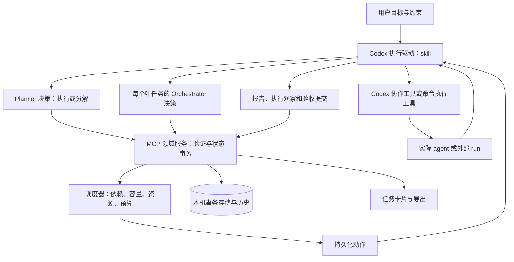
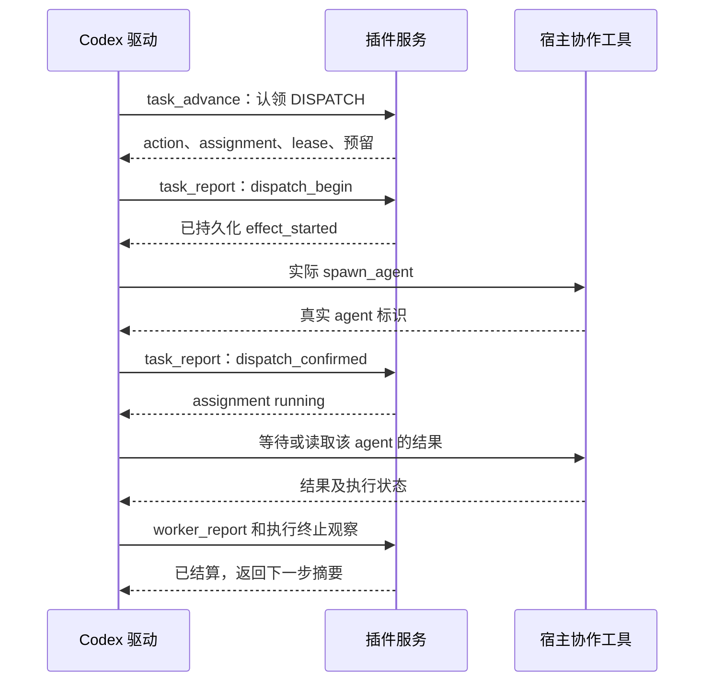

# Task Progress 任务编排设计

状态：开发设计，尚未实现。日期：2026-10-24（Asia/Shanghai）。

源码基线为 `dafb74a`，当前插件版本为 `0.1.0`。本文的 **v3 指数据与工具契约代际，不是已发布插件版本**。范围依据 [开发决策](../reviews/2026-10-24-development-decisions.md)；任务拆分、调度、实际分发、叶内编排和证据重建均为必做。开发拆分和测试矩阵见 [开发计划](../development/task-orchestration-v3-plan.md)。

## 1. 目标与完成定义

用户在 Codex 提交目标后，插件支持完整流程：恢复任务 → 规划分解 → 检查依赖与资源 → 实际派发 → 收集报告 → 继续调查或核验 → 分层验收 → 必要时带证据重建。

必须同时满足：

- 实际执行可以追溯到当前宿主返回的 agent/run 标识。
- 所有派发、结果与验收绑定到对应任务实例、计划轮次和尝试。
- 短任务可直接执行，仍使用同一模型和验收协议。
- 会话中断、响应丢失后先对账，防止盲目重复执行；任务返工使受影响验收失效。
- 当前状态与历史分开读取，卡片可说明正在做什么、为何等待、下一步和用户所需动作。

首版运行于 **宿主执行循环活跃期间**。MCP 服务不会自行唤醒 Codex，也不会直接调用仅存在于 assistant 工具环境中的 `collaboration.*`。宿主退出后，记录可恢复；不承诺无人值守的后台执行。

插件核心不依赖 Dagu 或任何特定命令队列服务。没有 Dagu 时，任务拆分、调度、Codex 派发、结果回收与验收仍应完整可用。用户工作区的命令路由规则由执行驱动遵守，不固化为插件的产品规则。

## 2. 架构和职责



| 层 | 负责 | 不承担 |
| --- | --- | --- |
| Planner | 使用目标、需求、前驱结果决定直接执行或细分；声明子任务覆盖哪些需求 | 实际启动 worker、把结构校验当成事实核验 |
| Orchestrator | 维护一个叶任务的上下文、报告和在途工作；选择 dispatch/wait/finish | 改写全局目标或其他叶子的计划 |
| MCP 领域服务 | 结构与状态校验、调度、动作认领、幂等、容量预留、证据与历史存储 | 自行调用模型、替代宿主授权 |
| Codex 执行驱动 | 消费动作，作出角色决策，调用真实执行工具，回填观察与报告 | 仅凭派发请求就声称 agent 已运行 |
| UI | 呈现状态和证据，按需读取历史，发出明确的控制请求 | 根据计时器自行判定任务成功、失败或已停止 |

首版以主会话驱动 Planner 和各叶子的 Orchestrator，两者有独立决策类型与上下文。需要独立上下文或并行控制时，可把 Orchestrator 委派为实际 agent；该 agent 同样占用真实容量。角色数量不等于进程数量，不为了套用架构而固定增加控制 agent。

### 2.1 代码模块

将当前 `server.py` 渐进拆分，保留其 stdio 入口：

```text
plugins/task-progress/
  server.py                         # MCP 路由、资源和协议错误
  task_progress/
    models.py                       # 模型、枚举、不可变标识
    store.py                        # SQLite 事务、幂等、迁移
    graph.py                        # 层级/兄弟依赖、有效结果和影响范围
    lifecycle.py                    # 状态、尝试、暂停和重试
    planner.py                      # 决策校验、需求覆盖声明
    scheduler.py                    # 动作生成、排序、容量和资源预留
    orchestration.py                # 叶内决策与报告集合
    dispatch.py                     # 派发确认、未知结果对账
    synthesis.py                    # 验收协议、结果版本
    recovery.py                     # 恢复上下文、新 epoch
    context.py                      # 有界上下文、引用与来源
    api_v3.py                       # 新工具输入输出
    compatibility.py                # 旧工具与数据投影
    views.py                        # 面板序号、分页与导出读取
  skills/track-progress/
    SKILL.md                        # 入口、角色循环、权限与路由
    references/executor-protocol.md
    references/planner-protocol.md
    references/orchestrator-protocol.md
```

文件名为计划；迁移过程中每一批都保持现有可用入口，不进行与功能无关的整体重写。

## 3. 不变量

1. 一个节点只能有一个父节点；依赖只引用同一父节点下的其他节点，依赖图无环。
2. 只有满足依赖的 pending 叶子才能规划或进入执行；`deferred` 叶子不能直接派发。
3. 原始任务目标和需求有版本；任务标题、规划理由与完整目标分开存储。
4. `finished` 表示返回了结果；`resolved/open` 表示解决程度；failed/cancelled 不等同于正常返回。
5. 子任务都结束不自动产生父级 resolved。验收必须显式提交、引用输入版本并记录验收者。
6. 记录派发意图、实际开始和实际结束是三个不同事件。
7. 响应丢失不等于外部操作失败。已进入外部派发阶段的动作不能仅因 lease 到期再次启动。
8. 旧 task instance、epoch、attempt、assignment 的结果只能留在原归属或迟到记录中。
9. 新鲜度不足只产生“待确认”提示，不能释放未知运行资源或自动标失败。
10. 暂停/取消请求不等于进程已经停止；容量和资源直到确认结束才释放。
11. 同一任务的新计划轮次保留旧证据来源，但不自动继承旧方案的完成状态，也不创建新任务实例。
12. 调度资格不增加外部操作授权；当前用户指令、项目规则和宿主权限始终适用。

## 4. 数据模型

### 4.1 标识和版本

| 字段 | 语义 |
| --- | --- |
| `installation_id` | 当前本地安装生成并持久化的标识，不取自工作目录 |
| `binding` | `{provider, conversation_id}`，由当前宿主/调用上下文明确提供；加 installation_id 唯一映射 session |
| `session_id` | 插件会话 UUID；同一聊天的多个任务复用 |
| `task_instance_id` | 一次用户目标的实例 UUID；新任务才改变 |
| `task_generation` | session 内单调递增的新任务序号，供卡片与实例切换比较 |
| `epoch` | 同一实例的计划重建序号 |
| `revision` | 当前实例的事务版本；递增，重建不归零 |
| `event_seq` | session 内单调递增事件序号，跨实例不归零 |
| `node_id` | 实例生命周期内唯一的节点 ID；重建后不复用 |
| `attempt_id` | 一次执行/规划/验收尝试 UUID；由服务端创建 |
| `assignment_id` | 一次具体 worker 或外部执行分配 UUID |
| `action_id`、`lease_token` | 调度动作与一次认领的 fence 标识 |
| `result_revision` | 一条节点结果的语义版本；消费者必须记录使用哪个版本 |

UUID 只用于身份，不用于排序。没有可靠 conversation ID 时使用显式 session ID，不从其他聊天、cwd 或 MCP 启动环境猜测身份。

### 4.2 主要实体

| 实体 | 必需内容 |
| --- | --- |
| Session | binding、当前实例、generation、event_seq、视图序号 |
| TaskInstance | 原始目标、需求版本、当前 epoch、control_state、预算、状态摘要 |
| Epoch | root_id、必填且非空的重建原因、恢复上下文引用、开始/结算时间 |
| Node | title、objective、requirement_ids、acceptance_criteria、parent/children、依赖、planning_state、执行状态、结果引用、资源声明 |
| Attempt | kind=`planning/execution/synthesis`、lifecycle、executor、输入版本快照、开始/结束、结果与错误；已结算记录不可改写 |
| Assignment | 叶 attempt、worker 角色、指令、指定配置、实际配置、action、真实执行标识、生命周期、资源预留 |
| Report | assignment、序号、final/partial、发现、缺口、证据引用、原文引用、收到时间；不可覆盖旧报告 |
| Result | node/attempt、outcome、摘要、逐项验收、来源、result_revision、validity=`current/stale` |
| Evidence | 类型、位置、来源任务/报告、内容或源版本标识、验证声明和提供者 |
| Action | 类型、目标、前置版本、状态、lease、请求摘要、外部关联标识 |
| RecoveryContext | 已支持发现、来源、未解决需求、停止原因和待尝试路线 |

旧 `assignment` 中的 model/effort 保留。新元数据允许分别为 null，但必须附 `unknown_reason`；`source` 区分宿主配置、显式派发参数及未核实。派发选择值与宿主确认的实际值分别保存；不把前者假装成后者。后补信息作为新审计事件，不修改旧快照。

### 4.3 节点结构示例

以下为拟议契约示例，标识与路径均为示例数据，不可直接用于真实任务：

```json
{
  "id": "implement",
  "parent_id": "root",
  "children": [],
  "title": "实施修复",
  "objective": "依据复现结果修复根因，并保持既有行为兼容",
  "requirement_ids": ["R1", "R2"],
  "acceptance_criteria": ["根因对应的受控用例通过", "相关旧行为仍通过"],
  "depends_on": [{"node_id": "reproduce", "policy": "resolved"}],
  "planning_state": "deferred",
  "execution_status": "pending",
  "activity": "idle",
  "priority": 0,
  "resources": [{"key": "workspace:/example/project", "mode": "write"}],
  "result_ref": null
}
```

`planning_state`：`deferred` 待规划，`executable` 可直接执行，`expanded` 已分解。`execution_status` 保留 pending/running/finished/failed/cancelled。`activity` 描述 active、waiting_workers、waiting_user、waiting_external、paused、interrupted 等当前活动，不承担解决程度判断。

Attempt 使用 `prepared/running/settling/finished/failed/cancelled` 生命周期。认领首次 ORCHESTRATE 时原子建立 execution attempt，先为 prepared；此时可作派发决策，但节点还不能宣称工作已经运行。实际执行开始后才转 running。规划和验收尝试按其真实角色决策过程记录，不能用 execution attempt 冒充。

TaskInstance.control_state 使用 `active/pause_requested/paused/cancel_requested/cancelled`；等待原因和执行活动单独记录。active 仅表示允许推进，不能推导任务尚未结束或已经成功；最终结论取当前有效根结果。pause/resume 不生成新结果或新任务实例。

## 5. 状态和依赖规则

### 5.1 就绪条件

```text
Ready(node) = leaf
              AND execution_status == pending
              AND 没有未结算的 attempt 或 assignment
              AND 所有依赖满足对应策略
              AND 所有已绑定输入结果仍有效

ReadyForPlanning = Ready AND planning_state == deferred
ReadyForExecution = Ready AND planning_state == executable

Dispatchable = executable 叶子有有效的 prepared/running execution attempt
               AND task 允许新派发
               AND 该次派发输入仍有效
               AND 容量/资源/预算可预留
               AND 当前执行器具备所需能力
```

Ready 用于创建首次角色动作。动作认领后，提交决策以该角色 attempt 和原输入仍有效为条件，不再要求“没有未结算 attempt”。prepared/queued 状态必须阻止另一个驱动重新创建首次执行。恢复 prepared attempt 时继续原尝试；只有确认不存在在途外部效果，才能显式取消或重试。

依赖策略按边记录：

| 策略 | 放行条件 |
| --- | --- |
| `resolved`（默认） | 前驱 finished、outcome=resolved、result current |
| `returned` | 前驱 finished、outcome 为 resolved/open、result current |
| `legacy_terminal` | 仅兼容旧 finished 策略；包含 failed/cancelled，必须传递错误与缺口 |

新规划仅使用前两种策略。旧数据不会被静默改成 returned。执行失败触发恢复/错误处理，不能伪装成有部分答案的正常返回。

### 5.2 状态转换

| 操作 | 前置条件 | 结果 |
| --- | --- | --- |
| `plan.execute` | 规划 attempt 有效，依赖和输入仍有效 | 节点变 executable，结算规划 attempt |
| `plan.decompose` | 规划 attempt 有效，依赖和输入仍有效；整批子节点和覆盖声明校验通过 | 原子安装子节点，父节点 expanded，结算规划 attempt |
| 认领首次 ORCHESTRATE | ReadyForExecution | 建立 prepared execution attempt，叶节点保持 pending |
| 外部执行确认已入队 | 正确 action/assignment 与真实 run 标识 | assignment 为 queued，叶节点 pending、activity=waiting_external |
| 确认首个实际执行开始 | 正确 action/assignment 与真实执行标识 | 叶节点 running；attempt 开始时间来自确认的观察 |
| 追加派发 | 叶 attempt 为 prepared/running、预算可用、没有重复未完成工作 | 新 assignment；不创建新的 HTN 子节点 |
| 提交叶结果 | 叶内 assignment 已全部结算；正常或部分收尾路径明确 | finished + resolved/open，生成 Result |
| 父级综合 | 必要子结果均已正常返回且 current | 创建 synthesis attempt；结果提交后父节点 finished |
| 必要子执行失败/取消 | 不能正常综合 | 进入恢复决策；预算收尾可汇总部分证据为 open |
| 任务取消 | 请求已登记；所有相关外部执行结算 | root/实例显示 cancelled，不显示 waiting_synthesis |

分组节点不作为 worker 直接运行；综合使用单独的 synthesis attempt。卡片可根据后代或综合 attempt 显示“处理中”。

父级 resolved 要求逐项验收结果和证据。open 子结果要求显式处理其缺口；不得仅凭所有子节点终止就通过。failed/cancelled 的必要子任务不能在没有范围修订的情况下被省略。正常综合、错误恢复和预算用尽后的部分收尾是不同路径。

部分收尾可以保留“未解决”的最终答案，但必须先结束或确认停止所有所属 assignment。外部执行仍未知时只能保存临时摘要并进入 settling，不能释放资源或把任务标成最终结束。

### 5.3 暂停、等待与新鲜度

- `pause_requested` 立即阻止新派发；按请求选择等待在途工作结束或生成停止动作。全部结算后才为 paused。
- `waiting_user` 保存所需输入；`waiting_external` 保存 provider/run 与最近一次确认的外部状态。
- UI 轮询只更新最近读取时间，不刷新执行器心跳。
- 超过新鲜度阈值显示“状态待确认”；driver 恢复后先读取真实执行状态。
- 实例 cancelled/paused 不允许新计划或派发，但允许结算已经存在的外部动作。

### 5.4 重试、返工与失效传播

首批只允许对未被验收、没有已启动消费者的叶子安全重试；其他情况要求新 epoch。随后实现 `reopen_branch`：

1. 计算受影响集合：目标节点；其结果的直接/间接消费者；失效结果的祖先综合结果；依赖这些综合结果的消费者。修改目标或结构时，还包含相应后代。
2. 按记录的输入版本和 context refs 扩展影响范围；不因祖先汇总失效就无条件重跑所有无关兄弟。
3. 若集合内还有在途/派发未知执行，拒绝提交返工事务，先结算或停止。
4. 保留旧 attempt、报告与结果，将受影响结果标 stale；祖先取消有效验收，相关消费者待复核。
5. 新 attempt 重新绑定前驱版本。不能只清空根节点的 completed 标签而继续使用过期证据。

全流程在事务中检查 expected revision；提交后旧结果不能满足任何新依赖。

## 6. Planner、调度器与 Orchestrator

### 6.1 Planner 协议

输入包括原始目标、当前节点目标、需求列表、祖先约束、已返回前驱摘要、源结果版本、恢复上下文和剩余结构预算。

输出只能选一项：

- `plan.execute`：剩余工作属于一次连贯的调查、实现、验证或综合；给出理由及执行要求。
- `plan.decompose`：提交完整的一批子节点、兄弟依赖、每项 requirement 的覆盖映射及分解理由。默认至少两个有独立价值的子任务。

服务端原子验证 ID、兄弟依赖、无环、最大深度/分支/节点数、非空目标及覆盖映射完整性。拒绝时返回具体字段和可修复原因，不安装半份计划，不截断超预算子任务。模型负责判断分解是否真正覆盖目标；字段完整只是必要条件。

未拿到前置结果时可保留一个 deferred 概要节点；不能预先细分后绕过其依赖。根节点首次规划也是相同协议。运行中的节点不得直接变为分组；先结算尝试，再通过受控返工或新 epoch 处理。

### 6.2 调度算法

一次 `task_advance` 在短事务中执行：

```text
恢复需要核对的派发和执行观察
生成 STOP / RECONCILE / COLLECT 动作
生成具备有效输入的 SYNTHESIZE / PREPARE_REBUILD 动作
处理当前波次的规划边界：若可推进，生成 PLAN 动作
为可执行叶生成 ORCHESTRATE 动作
为已接受的派发决策生成 DISPATCH 动作
按优先级和创建顺序选择动作
校验输入版本、宿主能力、预算和资源
原子认领可执行动作并预留必要容量，返回有界动作列表
```

同一目标、动作类型和输入指纹只生成一个有效动作。已被其他驱动认领的动作不再返回可执行 lease。

`preview` 只计算候选和阻塞原因，不持久化动作、预留资源或增加 revision；上述认领事务仅适用于 `claim`。

阶段内的 ready 叶子构成一波。叶内可以边收报告边继续协调；默认在该波结算后推进下一轮全局规划。结果仍及时落库并标记可综合父级；不必等慢 worker 才保存已完成报告。恢复请求先处理受影响在途工作，再建立新波次。

排序规则为：停止/对账优先，结果回收和综合其次，最后是新工作；同类先显式 priority，再创建顺序。优先级不会绕过依赖或资源限制。动作返回 `blocked_reasons`，区分依赖、容量、资源、预算和宿主能力不足。

### 6.3 容量与资源

- 执行器注册能力及带时间戳的容量观察；容量只属于该执行器实际可控制的作用域，不能把一个聊天的 agent 上限当成全用户上限。
- 已确认活跃、尚未启动的预留、派发未知均占用预算；主会话及独立控制 agent 按宿主真实容量语义计入。
- 计算可派发数时对宿主实际活跃标识与插件 reservation 去重，不能重复扣减同一 agent，也不能漏掉外部已活跃工作。
- 未知或过期容量不能用于新增并行派发；先刷新观察。仅在主会话具备能力时可选择主会话执行。
- 资源键在执行宿主规范化，工作区路径解析到实际位置；`read` 可共享，`write` 排他，父子路径覆盖关系视为冲突。缓存和外部资源使用显式全局键。
- 资源预留跨该安装内各会话协调，但不能阻止插件之外的进程改写文件。执行前仍须验证必要的 Git/source 身份。
- 写入资源不明确时，默认预留整个工作区写权限；共享缓存未知时不并发执行相关命令。
- 控制角色不长期占用 worker 写锁。停止动作和对账动作不被“无新 worker 容量”阻塞。

### 6.4 Orchestrator 协议

输入为独立叶上下文：`C`（目标及证据）、`R`（已返回报告）、`A`（在途分配）、预算及能力。输出：

| 决策 | 必需内容 | 服务端检查 |
| --- | --- | --- |
| `orchestrate.dispatch` | 角色、完整目标、指令、预期交付、依据、资源、配置、拟解决缺口 | 仍有价值的缺口、指令指纹不重复、容量可等待预留、预算允许 |
| `orchestrate.wait` | 等待哪个 assignment/run/input，等待原因 | 等待对象存在；若既无在途工作也无外部输入，则返回无进展错误 |
| `orchestrate.finish` | 摘要、outcome、逐项验收、证据和缺口、剩余派发处理方式 | 输入上下文仍有效；没有未经处理的在途/未知派发 |

`researcher/implementer/verifier` 为初始角色模板，最终权限来自原任务与宿主。需要独立验证的验收项必须有不同执行分配的核验报告；调用过 verifier 不等于验证通过。执行配置不从模板名称推断。

没有实际派发必要时，选择 `main_session` 执行一个 assignment；记录主会话执行身份和观察，不伪造外部 agent ID。多 worker 在 assignments/reports 中表示，不把每次搜索都升级为 HTN 节点。

## 7. 实际分发协议

### 7.1 动作与 assignment 状态

| 对象 | 状态 |
| --- | --- |
| Action | pending → leased → effect_started → applied；另有 cancelled、failed、reconciling |
| Assignment | planned → reserved → dispatching → queued/running → finished/failed/cancelled；派发/停止结果不明时为 unknown/stopping |

认领返回不可复用的 lease_token。lease 仅约束动作处理权，不代表外部 agent 的存活租约。

无外部效果的 PLAN/ORCHESTRATE/SYNTHESIZE 提交可由 leased 直接变 applied。effect_started 用于真正可能产生外部效果的动作；STOP 同样需先记录意图，不能把“已发停止请求”当作已停止。过期后以 provider 的真实状态对账，不因为纯决策未提交而假设启动过 worker。

queued 用于具有队列能力的外部执行器，收到执行标识只能确认已提交；只有 provider 报告 running 才能标运行。无需排队的执行器可直接确认 running。agent 容量与外部队列容量分别计量，不能把一个外部 run 当成一个 Codex agent。入队任务保留必要资源预留，取消请求也要等 provider 确认终止。下图表示宿主明确确认已运行的 agent 路径。



协议的关键边界：

1. `dispatch_begin` 必须先于实际外部调用持久化。只有 begin 前的 lease 超时才可安全重新排队。
2. 外部调用返回明确失败时记录错误；没有返回时转 reconciling/unknown，保留预留，禁止自动重派。
3. 在完整派发文本中携带不含敏感信息的关联标识。驱动通过当前宿主的 agent 清单、已知工具结果或 provider 提供的查询能力对账。
4. 单次“活跃列表中未看到”不足以证明从未创建；证据不足则保持待确认，不能承诺外部执行恰好一次。
5. 过期 lease 的回报不得直接推动当前状态；转对账路径。若实际执行仍存在，必须保留其记录和资源影响。
6. 收到报告和进程终止是不同事件。partial 报告不释放资源；final 报告也需与真实终止观察结合。

### 7.2 Codex 执行驱动循环

驱动放在插件 skill 和角色参考协议中，依托当前 assistant 的实际工具执行，Python 服务不跨层调用 `collaboration.*`：

```text
打开/恢复当前任务，注册当前宿主能力和配置来源
循环：
    回收已知在途 agent/run 的新结果和状态
    调用 task_advance 获取有界动作
    PLAN：按 Planner 协议思考，task_decide 提交
    ORCHESTRATE：按该叶的独立上下文决策，task_decide 提交
    DISPATCH：持久化 begin → 调用真实工具 → 回填真实标识
    COLLECT：等待/读取指定执行，提交报告与状态
    SYNTHESIZE：逐项验收，task_decide 提交结果
    STOP/RECONCILE：实际调用停止或读取工具，再回填观察
    PREPARE_REBUILD：整理可引用证据，提交重建决策
    无可执行动作：按具体原因等待、请求必要输入或结束本轮驱动
    根任务有有效最终结果：报告结果并结束
```

等待必须有界并给用户留出响应机会；按当前运行环境限制执行，单次阻塞等待不超过 60 秒。新用户输入先处理，再决定当前动作是否仍有效。

第一版不通过 `create_thread` 代替子智能体。使用当前允许的协作工具；真实模型和思考强度取自本次宿主/派发配置。主会话暂停、工具不可用或权限不允许时，记录阻塞原因，不编造执行成功。

### 7.3 通用外部执行协议

外部执行引用保存 `{provider, execution_id, observed_status, observed_at, source_identity}`，可附 `provider_metadata`；对应 API 使用 `provider_ref` 承载该引用。不把命令日志全文塞进节点摘要。`execution_id` 是实际工具返回或由适配层无损映射的执行身份，不要求执行器具有 workflow 或 queue 概念。

Codex 执行驱动根据当前宿主工具和工作区规则选择执行方式，将实际启动、读取、停止及对账结果映射为统一事件。可使用宿主命令工具、本地进程或用户已配置的外部服务。核心只处理标准状态、身份、资源和结果，不导入特定服务 SDK、不探测其安装，也不按服务名称分支决定任务是否可执行。首版只实现所需的 Codex 驱动和通用事件协议，不同时建设多服务适配框架。

执行器声明实际支持的 start/observe/stop/reconcile 能力；排队能力可选。不支持停止时展示能力限制并等待终止；不能查询历史时，派发结果未知必须保持待确认，不能伪造对账结论。已有可查询执行需按相同源状态和命令先核对，避免重复提交。提交、排队、运行、终止和验证结论分别记录。

路由政策来自用户或目标工作区，不内置“一分钟以上必须走某队列”等规则。工作区明确指定的执行方式不可用时，只阻塞受该规则约束的动作；未指定外部服务时，可正常使用当前允许的宿主执行工具。路由选择本身不增加提交/推送授权。

Dagu 只是可选映射示例：若目标工作区已经使用它，驱动可调用现有工具，把 `workflow_name`、`run_id` 等定位字段放入 `provider_metadata`。安装 Dagu、开发专用适配器或通过 Dagu 集成测试，均不是插件核心交付的前提。当前开发工作区的 Dagu 约定仅属于开发流程，见开发计划的执行约束。

## 8. 综合、证据与重建

### 8.1 结果协议

验收结果包含 `outcome`、summary、`requirement_results`、evidence_refs、unresolved 和输入 result refs。每个需求结论为 satisfied/unresolved；范围被用户改变时，通过带来源的目标修订或新 epoch 表示，不用随意的“忽略”绕过。

结构服务检查所有必要需求都有结论、引用可解析、输入版本有效、验收者和时间存在。模型/执行者负责语义正确性，服务不宣称能仅凭 JSON 判断事实为真。根 resolved 必须满足全部当前需求；否则为 open 或进入恢复。

证据区分测试、文件、图像、网页、外部 run 和人工确认；保存可定位引用及源版本。测试通过必须有对应测试运行与源状态；旧截图或旧报告只能证明其自身版本。导出使用相同结果数据源，不能另算成功率。

### 8.2 恢复上下文

重建分两阶段：先收敛在途动作并准备上下文，再以 expected revision 提交新 epoch。恢复上下文最少包括：

```json
{
  "supported_findings": [
    {"claim": "受控输入可稳定复现该行为", "evidence_refs": ["ev-repro"], "source_result_ref": "result-repro-1"}
  ],
  "unresolved_requirements": ["R2"],
  "stop_reason": "当前实现路线未满足兼容要求",
  "next_routes": ["检查替代实现路线"],
  "source_epoch": 0
}
```

引用必须指向真实保存的证据；无法核实的猜测单独标记，不能进入 supported_findings。来源是文本时允许记录精确支持片段及出处；来源是运行/文件时保存其版本身份和结果。迁移旧 `evidence: string[]` 不自动提升为已验证事实。

新根目标沿用当前需求版本，保存 recovery_context_ref，所有新节点重新规划和验收。旧 epoch 不再接收改变其结论的写入，迟到报告另存供审计。最多重建次数和预算在此处再次检查。

## 9. MCP API v3 契约

以下工具和参数为开发目标，当前 `0.1.0` 尚不提供。新工具统一返回 `api_version: 3`，与旧工具并存迁移，禁止让旧调用方误认新语义。

### 9.1 工具目录

| 工具 | 核心输入 | 主要返回 |
| --- | --- | --- |
| `task_open` | mode=ensure/new/resume；binding 或 session_id；新目标/需求；executor 能力；可选 initial_plan | scope、当前摘要、是否恢复、协议能力；可原子提交初始计划 |
| `task_read` | scope；projection=summary/node/context/events；node/action/cursor | 当前摘要、单节点、动作上下文或增量事件；不隐式返回全部历史 |
| `task_advance` | scope、request_id、executor_id、mode=preview/claim、max_actions | ready/blocked 原因、动作；claim 模式返回 lease 和 reservation |
| `task_decide` | scope、action_id、lease_token、kind、决策数据及输入版本 | 计划、叶内决策、综合或重建的提交结果和下一步摘要 |
| `task_report` | scope、request_id、event_kind、对应 action/assignment、provider 观察或 worker 报告 | 已接收事件、实体版本、结果归属；不以报告文本直接覆盖任务终态 |
| `task_control` | scope、request_id、operation、expected revision、原因及必要来源 | pause/resume/cancel/retry/reopen_branch/edit_plan/update_executor/answer_input 的确定结果 |
| `task_history` | session、type=task/epoch/attempt；epoch 必须指定 task_instance_id，attempt 还需节点范围；cursor、limit | task 为会话其他归档任务，epoch 为指定任务的旧方案；分别返回分页及只读快照 |

`task_open.ensure` 找到现有任务时只恢复，不改目标、不归档；若没有当前 v3 任务且请求包含目标，则创建首个任务（新 session 或已有空 session 均可）。`resume` 仅恢复，session 或任务不存在时返回明确错误。旧版 session 未迁移到 v3 时不能把附带新目标的 `ensure` 当成重规划；调用方须沿用旧接口，或先显式迁移，避免把同一目标创建为新任务。`new` 仅用于开始另一个独立任务，显式归档原任务、创建新实例并增加 generation；同一任务的方案调整使用重建，不调用 `new`。

每次重建都必须提交非空且可解释的 `reason`：说明为何旧计划需要替换、哪些新事实/验收缺口/约束触发调整、后续计划因此如何改变。服务端拒绝缺失或空白原因，并把原因原子保存到关闭的旧 epoch；历史计划界面始终显示“重建原因”。旧数据没有该字段时显示“未记录（旧版计划）”，不得推测补写。有未结算执行则拒绝。binding 不可用时首次生成 session_id，之后由调用方明确复用。

控制请求仅产生计划和状态变化；pause/cancel 所需的真实停止仍经 STOP 动作兑现。`edit_plan` 只接受尚未消费的计划修改；影响有效结果时必须走 reopen/rebuild。

`answer_input` 是 UX 输入流程所需的拟议契约：保存 input_request_id、问题版本、明确提交的用户答复和来源。校验该问题仍待回答、回答类型与范围一致；已失效问题不改变当前任务。回答提交不等于外部操作授权，也不自动完成验收；若答复改变目标范围，先应用目标修订/返工规则。接口尚未实现的客户端应回到聊天收集答复，不能伪装已提交。

### 9.2 写入信封和并发控制

所有持久化变更有 request_id；实例内写入带 scope：

```json
{
  "request_id": "018f3a20-0000-4000-8000-000000000001",
  "scope": {
    "session_id": "018f3a20-0000-4000-8000-000000000002",
    "task_instance_id": "018f3a20-0000-4000-8000-000000000003",
    "epoch": 0
  },
  "expected_revision": 7,
  "action_id": "action-plan-implement",
  "lease_token": "example-fence-token",
  "kind": "plan.execute",
  "decision": {"node_id": "implement", "rationale": "剩余工作可作为一次独立实施完成"}
}
```

版本检查按操作作用域执行：

- 创建新实例校验当前 generation；计划/范围/重建操作校验实例 revision。
- 叶内决策校验 execution attempt version 和 context_digest，避免其他叶子的独立报告造成无关冲突。
- worker 报告校验 assignment 身份、单调报告序号和实体版本；不要求全局 revision 不变，以支持并行回报。
- 动作认领校验 action version、lease 和当前输入有效性；预留在同一事务中提交。
- 持久化每次变更仍增加实例 revision 与 session event_seq，供 UI/查询排序。

处理顺序为：验证请求格式 → 查询幂等回执 → 检查 scope/版本/前置条件 → 提交状态、审计与回执。相同 request_id、相同规范化参数返回原结果；同 ID 不同内容返回冲突。回放旧回执不产生新动作；响应标记 replayed，客户端必要时再读最新状态。

回执或至少 ID/摘要/结果引用的 tombstone 保留到任务显式删除，不能因清理大响应就把旧请求重新执行。

### 9.3 `task_report` 事件类型

| event_kind | 关键数据与处理 |
| --- | --- |
| `dispatch_begin` | action、lease、assignment；记录即将产生外部效果，消费一次派发尝试额度 |
| `stop_begin` | STOP action、lease、目标 provider_ref；持久化停止意图，不释放资源 |
| `lease_renew` | action、当前 lease_token；有效持有者续期，不刷新执行心跳，不复活已过期 fence |
| `dispatch_confirmed` | 真实 provider_ref、实际配置来源；关联外部执行，必要时等待明确 running 观察 |
| `dispatch_failed` | 明确工具失败证据；区分未创建与结果未知 |
| `execution_observed` | provider_ref、queued/running/terminal、观察时间和来源；乱序观察不能回退终态 |
| `worker_report` | assignment、report_seq、partial/final、内容/引用；重复报告幂等 |
| `main_session_transition` | 主会话真实执行身份、可选 finish 结果与 start 观察；仅对 executable 叶子原子结算当前项并登记下一项开始 |
| `reconcile_result` | 对账证据与 found/not_created/unknown；not_created 需要充分来源 |
| `stop_observed` | 已停止/仍在运行/未知；确认结算才释放资源 |

陈旧报告返回 `accepted_as_historical`，写入原尝试或迟到审计，不更新当前 epoch；语义冲突或身份不匹配返回错误。旧阶段的对账可维护全局活跃执行/资源事实，但不能修改新阶段结果。

短顺序任务使用 `task_open.initial_plan` 和一次仅含 start 的 `main_session_transition`，最多两次调用完成初始计划与首项开始登记。后续 finish + start 在同一事务中校验：先验收当前叶结果，再重算下一项依赖与预算，任何一步不满足则整体拒绝。开始必须有当前主会话的真实观察，不能预填子智能体或外部 run 的开始。该路径不能跳过 deferred 节点的规划、父级综合、独立核验要求或资源校验；外部派发始终使用 begin/confirm 协议。

### 9.4 错误和精简响应

领域错误通过 MCP tool result 的 `isError` 与结构化 code 返回；协议错误仍走 JSON-RPC 错误。至少定义：

`SCOPE_STALE`、`REVISION_CONFLICT`、`IDEMPOTENCY_CONFLICT`、`NODE_NOT_READY`、`PLAN_INVALID`、`CONTEXT_STALE`、`LEASE_STALE`、`DISPATCH_UNKNOWN`、`RESOURCE_CONFLICT`、`CAPACITY_UNAVAILABLE`、`BUDGET_EXHAUSTED`、`EXECUTOR_UNAVAILABLE`、`RETRY_REQUIRES_REOPEN`、`MIGRATION_REQUIRED`、`LEGACY_CONFLICT`。

每个错误带可读原因、相关实体和恢复动作；不把用户可修复的冲突伪装成服务内部异常。

成功响应默认只含 scope、revision/event_seq、变更实体摘要、next-ready、blocked reasons 和分页指针。派发上下文通过指定 action 的 context projection 获取；仅必要上下文随动作内联。不得给所有变更附完整任务历史。

模型侧短摘要与 App 读取分离；App 可以调用仅面板可见的读取/视图协调工具。纯文本客户端仍得到当前状态、阻塞原因和下一步。详细派发与证据过长时返回带长度/截断说明的引用，不能静默截断任务约束。

## 10. 存储、事务与升级

### 10.1 选择

v3 采用本机 Python 标准库 `sqlite3`，位置为当前缓存根目录下的 `progress.sqlite3`。原因是状态、动作认领、资源预留和幂等回执需要跨实体原子提交。仅依靠多个 JSON 文件替换难以保证这些记录在崩溃时一致。

当前表为事实来源，事件表用于审计和增量读取；首版不建设通用事件回放框架。核心表按 session/task/epoch/node/attempt/assignment/report/action/reservation/result/evidence/recovery_context/request_receipt/event/view 划分，复杂不可变载荷可用 JSON 字段；身份、版本、状态及索引字段显式存列。

数据库仅用于该安装的本机存储，不作为远程共享数据库。启用外键；写事务短小；竞争失败返回可重试的明确错误。不能在事务内执行模型调用、外部工具或长时间等待。动作预留、状态变更、event 和 receipt 同一事务提交。

外部效果无法与本地事务原子提交，所以使用第 7 节的 begin/confirm/reconcile 协议，不能依赖数据库事务宣称外部恰好一次执行。

### 10.2 JSON 兼容与迁移

1. schema 1/2 原文件先做只读检查，保存来源路径、哈希和备份；不因升级直接删除。
2. 在无 running/unknown 执行的迁移窗口导入 session、历史、epoch 和 attempt；活动任务先完成/暂停并核对实际执行。
3. 暂存导入不可被新 API 当成完整任务读取；校验通过后事务切换 active storage，失败仍读原记录。
4. 非兄弟依赖、非法状态等旧数据保留可读可导出；进入 v3 可执行模式前显式迁移或重建，不静默改变其行为。
5. 旧工具通过 compatibility 层保留已发布的字段和历史语义；旧线性记录继续查看和完成，新增编排走 v3。
6. 升级需重载旧 MCP 服务实例。检测到迁移源 JSON 被旧进程继续改写时返回 LEGACY_CONFLICT，停止对应 session 写入并要求核对，不能默默覆盖任一侧。
7. 大记录迁移使用独立本地迁移命令及原有 session 文件锁；按实际耗时路由，不能让 stdio 初始化超过配置中的启动超时。工具链只有完整迁移成功才启用 v3 写入口。

备份使用一致性快照；损坏文件保留诊断，禁止自动重置为空。回退恢复到明确的旧格式快照；v3 独有信息保留在新库/导出中，不承诺降级后旧插件仍能完整编辑它们。

### 10.3 历史与导出

session 只保存当前实例指针，两类历史独立读取并沿用原版名称：

- **历史任务**：同一 session 中此前创建并归档的其他独立任务，以不同 `task_instance_id` 区分。是否相关不是入选条件；不相干的读书笔记和目录清理任务同样属于此列表。只在开启新任务并归档原任务时增加，不将重规划的子任务或旧方案当作新任务。
- **当前任务的历史计划**：同一 `task_instance_id` 下被替换的旧 epoch。重建保持任务实例不变，只归档旧方案并递增 epoch；当前有效 epoch 不在历史计划列表内。
- 归档任务自己的历史计划仍属于该归档实例，在其详情中显示“此任务的历史计划”，不进入当前任务的历史计划列表。

默认页大小 20，最大 100；cursor 绑定 session、历史类型、所属 task/epoch 范围和快照版本，失效或范围不匹配时要求重新读取。两个 UI 入口并列、独立展开，不因查看快照而切换当前实例或触发执行。

导出先选择范围与格式，默认当前任务摘要，不强制同时生成 Excel/HTML。完整记录或历史导出从选定范围的一致快照取齐分页，标明源版本和导出时间。归档任务的耗时冻结到终止/归档时点；不能在离线报告里继续增长。后续机器可读导出保留 schema_version，导入首先作为只读历史，需显式转新任务才可执行。

## 11. UI 同步与交互

具体信息架构、状态文案、交互与可访问性规范见 [UX 优化设计](task-orchestration-v3-ux.md)，配有 [离线交互稿](ux-v3/index.html)。

卡片头部展示：当前活动、整体验收状态、已结束/总数、已解决/未解决、主要阻塞和最近执行观察。模型配置作为可展开信息，unknown 不阻塞状态展示。

产出、未解决事项和检查引用归入对应任务节点详情，根节点保存综合结论与子结果引用；不建立独立“任务结果”分区。节点投影返回带 owner scope 与来源版本的 result/evidence 引用，点击按实际引用读取，避免不同任务项打开通用内容或混入其他轮次。历史节点读取归档快照，不能通过同名当前节点补充。

比例以当前 epoch 的叶节点为分母，finished/failed/cancelled 计入“已结束”，只有 current + resolved 的结果计入“已解决”。分解改变分母时明确显示计划变化，不承诺百分比单调增长；100% 已结束仍可能等待父级验收或保留未解决项。旧 epoch 的节点不混入当前比例。

- 数据排序使用 task_generation 与 revision，跨实例事件用 event_seq；同一实例重建仍保持 revision 单调。
- 展示动作由服务端签发持久化 `view_seq`，轮询不增加它；旧卡片延迟登记携带旧 seq，不能抢占新卡片。
- 同一个展示回执的重复 iframe 可共享同一视图身份，不能靠后挂载时间互相驱逐。
- 旧卡片保持原实例快照/折叠提示；最新卡片分别提供“当前任务的历史计划”和“历史任务”入口。新实例不能被旧响应替换。
- 现有每 5 秒轮询作为活跃时兜底；不可见时停止，终态或长期等待时降低频率。具体宿主支持经过验证后再启用通知驱动刷新。
- 展开节点、证据或历史才加载详情；增量读取断档返回 `resync_required`，再取当前快照。
- 暂停/恢复/取消按钮展示实际语义；取消请求后仍有外部执行时显示“正在停止”，不直接展示“已取消”。

## 12. 默认限制与配置

以下是拟议首版保守默认值，不是性能实测结论。任务创建时冻结预算快照；修改预算必须有单独事件和原因。

| 配置 | 初值 | 达到上限时 |
| --- | --- | --- |
| 最大深度 / 每次分支 / 当前 epoch 节点 | 4 / 6 / 128 | 拒绝超限分解，要求合理合并或直接执行；不截掉任务 |
| 同时活跃 worker | min(2, 当前宿主可用容量) | 等待资源，不能猜测宿主容量 |
| 每叶派发决策轮次 / 全任务派发尝试 | 4 / 12 | 停止新派发，综合已有证据 |
| 最大重建次数 | 1 | 输出已有证据与未解决要求 |
| 任务调度墙钟窗口 | 7,200 秒 | 停止新增工作并进入收尾；不自动杀死未知外部 run |
| 动作 lease | 60 秒，可由有效持有者续租 | begin 前可重新排队；begin 后必须对账 |
| 新鲜度提示 | 120 秒未收到执行观察 | 显示待确认，不改变完成/失败状态 |
| 单次返回动作 / 上下文字符预算 | 8 / 24,000 | 分页或返回可按需读取的引用 |

外部命令的已声明期限可能更长，应在派发前显式配置匹配的调度窗口。已经开始的外部执行按其实际终态结算；时间用尽不释放未知占用，也不将成功假定为失败。停止新派发后仍保留必要的回收/停止/验收动作。

派发尝试在 dispatch_begin 计入，主会话快速路径在 start 被接受时按同一额度计入；已确认实际启动另计，重复回执不重复扣减。未知派发不能按零消耗重试。预算统计不伪装为准确 token 或费用统计；没有宿主数据就显示未知。

## 13. 兼容与发布约束

- 新 API、数据库 schema、App 与 skill 同一发布包交付；发布版本需统一更新 manifest、serverInfo、App appInfo 和变更说明。
- 新 Python 代码仍优先标准库；目标最低版本为 Python 3.10，开发计划以 3.10 和当前 3.12 环境验证。最低版本及 sqlite3 模块必须由启动器检查，不仅靠找到任意 `python` 就认为兼容。
- 老客户端得到可读摘要和兼容投影；不能用旧 API 启动自己无法表示的 v3 编排状态。
- 每个里程碑可以发布修复，但只有开发计划中的真实多智能体验收完成后，才能描述为支持完整任务编排。
- 本文不要求管理模型账户、后台唤醒、自动合并发布、多框架适配或大型图编辑器。

## 14. 设计来源与适配

[论文对照报告](../reviews/2026-10-24-htn-orchestrate-alignment.md)记录了固定论文版本和作者源码。本文采用其结果驱动规划、叶内协调、分层综合和带证据重建思路；接口命名、SQLite、lease、会话绑定和 UI 协议均是本插件的工程设计，不是论文声称提供的能力。

工程依赖默认 resolved、研究证据边可选 returned；这是明确的产品适配。当前源码的缺陷及复现边界见 [插件审查](../reviews/2026-10-24-plugin-audit.md)。
